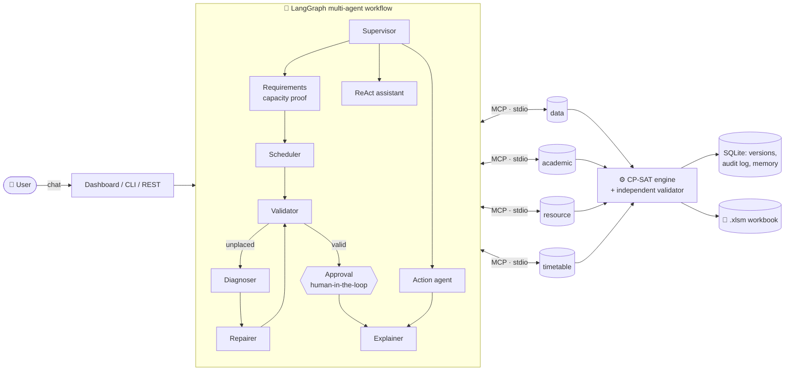
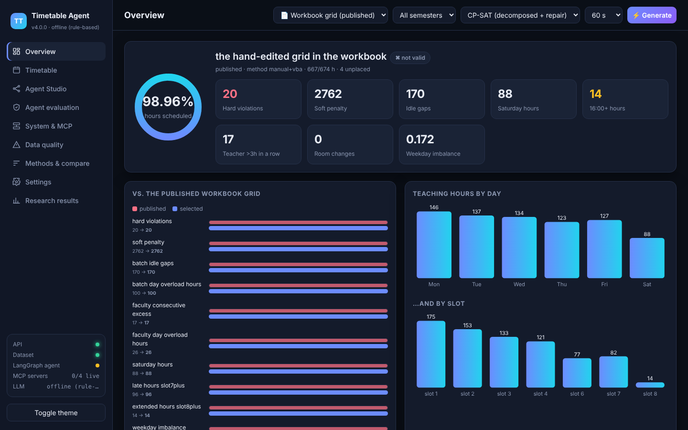
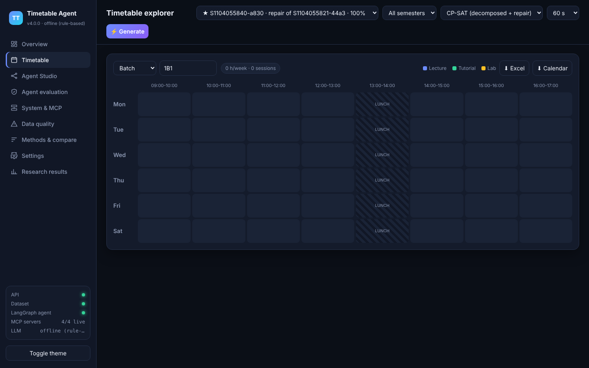
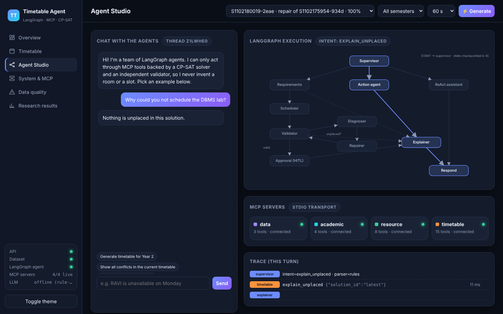
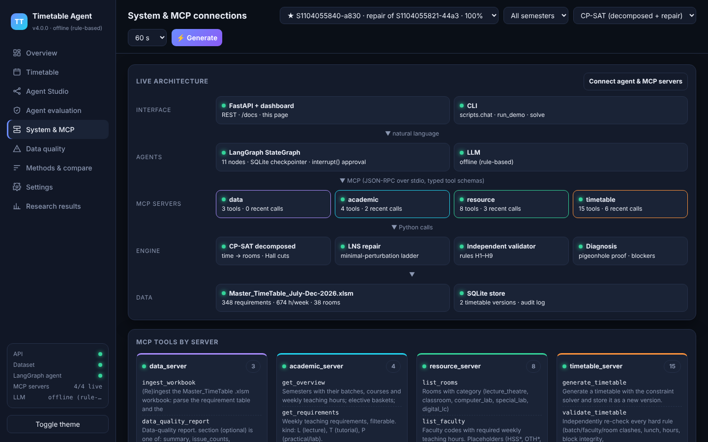
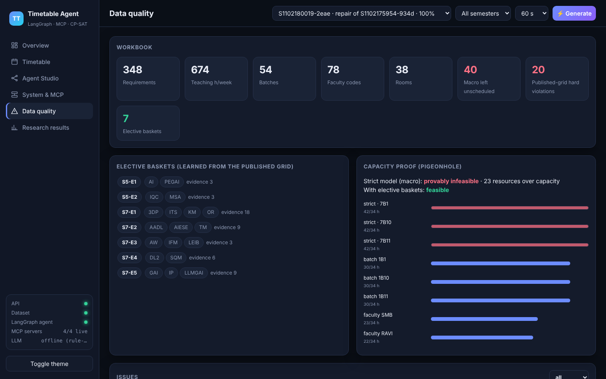

<div align="center">

# 🗓️ University Timetable Agent

**Agentic AI that builds, validates, explains and repairs a real university timetable:
LangGraph agents · Model Context Protocol (MCP) · OR-Tools CP-SAT**


**100% of 674 weekly teaching hours scheduled · 0 hard-constraint violations · works offline, LLM optional**


🎬 **[Watch the 2-minute demo video](docs/media/demo.mp4)** · 🆕 [v3 analysis: GA & ITC-2007](docs/V3_ANALYSIS.md) · 📄 [Project report (Word)](docs/Project_Report.docx) · 📘 [User guide](docs/USAGE.md) · 🏗️ [Architecture](docs/ARCHITECTURE.md) · 🔬 [Research report](docs/RESEARCH_REPORT.md)

</div>

---

## Contents
1. [What it does](#-what-it-does)
2. [Key results](#-key-results) · [What's new in v3](#-whats-new-in-v3)
3. [How it works](#-how-it-works)
4. [Screenshots](#-screenshots)
5. [Quick start](#-quick-start)
6. [Ways to use it](#-ways-to-use-it)
7. [Repository structure](#-repository-structure)
8. [Configuration](#-configuration)
9. [Testing & research reproduction](#-testing--research-reproduction)
10. [FAQ & troubleshooting](#-faq--troubleshooting)

---

## ✨ What it does

A university's timetable lives in a macro-enabled Excel workbook (`Master_TimeTable_July-Dec-2026.xlsm`)
that a VBA macro fills greedily, followed by manual fixes. This project replaces that with an **agentic system**:

| You ask (plain English) | What happens behind the scenes |
|---|---|
| *"Generate timetable for Year 3"* | Supervisor → capacity proof → **CP-SAT solver** → **independent validator** → repair loop if needed → **human approval** → explanation |
| *"RAVI is unavailable on Monday"* | Constraint recorded → **minimal-change repair** (moves only the sessions it must) → re-validation |
| *"Why could you not schedule the DBMS lab?"* | For every possible slot: which batch / teacher / room blocks it, plus free slots and rooms that would work |
| *"Show timetable of batch 1B1"* · *"faculty JP"* · *"room LT1"* | A weekly grid from the selected timetable version |
| *"Compare with the published timetable"* | Side-by-side quality metrics |
| *"How good is the data in the Excel workbook?"* | Data-quality audit of the workbook |

**The core rule: the LLM never schedules anything.** It can only call typed MCP tools. Every room, slot and
teacher assignment comes from the constraint solver and is re-checked by a validator that shares no code with it.

## 📊 Key results

Measured on the real workbook (348 requirements, 674 h/week, 54 batches, 38 rooms, 78 faculty codes):

| Method | Hours scheduled | Hard violations | Idle gaps | 16:00+ classes |
|---|---:|---:|---:|---:|
| Published grid (VBA macro + manual edits) | 98.96 % | **20** | 170 | 14 |
| VBA `Allot` macro (faithful Python port) | 88.13 % | 4 | 238 | 0 |
| CP-SAT, single model | 71.81 % | 0 | 268 | 0 |
| **This project (decomposed CP-SAT + LNS repair)** | **99.85 – 100 %** | **0** | **110** | **0** |

Findings that came out of the real data:

- 🔍 **The macro's model is provably infeasible.** Semester-7 batches need 42 h/week and semester-5 batches 35 h,
  but a week has only 34 teachable hours. That is why the macro always leaves 40 rows unscheduled.
- 🧠 **Elective baskets learned from the data.** The system infers 7 groups of parallel electives from how
  staff actually scheduled them, which makes the problem feasible.
- 🏫 **Requested venues are preferences.** LT4 alone is requested for 51 h/week, so the solver chooses rooms.
- 🔧 **What-if repairs touch only 0.5–7 % of sessions**, instead of rebuilding the whole timetable.

Full method, ablations, robustness and threats to validity: **[docs/RESEARCH_REPORT.md](docs/RESEARCH_REPORT.md)**.

## 🆕 What's new in v3

| Area | v3 addition |
|---|---|
| **GA comparison** | A memetic genetic algorithm (`ttagent/engine/ga.py`): legal-candidate encoding, requirement-level crossover, conflict-directed local search, incremental evaluation. Selectable everywhere (`--method ga`, dashboard method selector) |
| **Statistics** | 5 seeds per method, Mann–Whitney U and Cliff's δ, anytime curves, per-semester breakdown, heatmap case study |
| **Public benchmark** | ITC-2007 Track 3 (all 21 instances), UD2 scorer, CP-SAT and GA solvers, comparison with published results |
| **Limitations fixed** | real seat counts and class sizes (optional YAML), teacher time preferences, elective-basket confidence, disruption-vs-quality study of repair |
| **Software** | installable package with a `ttagent` command, double-click launcher (`TimetableAgent.bat`), settings page, workbook upload, head-to-head method comparison in the dashboard |

On the real workbook (5 seeds × 120 s):

| Method | Hours scheduled | Hard violations | Soft penalty / scheduled h |
|---|---:|---:|---:|
| Published grid | 98.96 % | 20 | 4.14 |
| VBA macro (port) | 88.13 % | 4 | 4.35 |
| Memetic GA | 98.10 ± 0.57 % | 0 | 4.34 |
| **CP-SAT pipeline** | **99.76 ± 0.31 %** | **0** | **3.38** |

CP-SAT beats the GA in every run (Cliff's δ = 1.0, p = 0.011) and on all 21 ITC-2007 instances, where it
also proves 3 instances optimal. Details, the qualitative comparison and the limitations of the comparison:
**[docs/V3_ANALYSIS.md](docs/V3_ANALYSIS.md)**.

## 🧩 How it works



| Layer | What it is | Uses an LLM? |
|---|---|:-:|
| **Agents**: `ttagent/agents` | LangGraph `StateGraph` with 11 nodes, conditional routing, a repair loop, `interrupt()` for approval, and a SQLite checkpointer so conversations survive restarts | optional |
| **MCP**: `ttagent/mcp_servers` | 4 FastMCP servers (data, academic, resource, timetable) exposing 30 typed tools, 2 resources and 1 prompt; every call is audited | ❌ |
| **Engine**: `ttagent/engine` | Time-then-room **CP-SAT decomposition** with Hall cuts, **LNS repair ladder**, exact CP-SAT model, VBA-macro port, validator (rules H1–H9), pigeonhole capacity proof, diagnosis | ❌ |
| **Ingestion**: `ttagent/ingestion` | Reads the `.xlsm` exactly as the macro does, parses `1B1,1B2:P-CPLAB@CL3_REENU,RP` tokens, infers rooms, placeholders and electives, and writes a quality report | ❌ |

The agent graph exactly as LangGraph compiles it is in [`docs/agent_graph.mermaid`](docs/agent_graph.mermaid). More detail: [docs/ARCHITECTURE.md](docs/ARCHITECTURE.md).

## 🖼️ Screenshots

| Overview | Timetable explorer |
|---|---|
|  |  |
| **Agent Studio**: live LangGraph path, MCP servers and trace | **System**: live architecture and every MCP tool |
|  |  |



## 🚀 Quick start

**Requirements:** Python 3.10–3.14. No API key is needed.

**Windows, one click:** double-click `TimetableAgent.bat`. It installs everything on first run, loads the
workbook and opens the dashboard. (`./run.sh` on macOS/Linux.)

**Manual:**

```powershell
git clone https://github.com/<your-username>/university-timetable-agent.git
cd university-timetable-agent

python -m venv .venv
# Windows PowerShell:
Set-ExecutionPolicy -Scope Process -ExecutionPolicy Bypass
.venv\Scripts\Activate.ps1
# macOS / Linux:  source .venv/bin/activate

python -m pip install -e .               # installs the `ttagent` command
ttagent ingest                           # parse the workbook (a few seconds)
ttagent serve                            # → opens http://127.0.0.1:8000
```

In the dashboard, click **⚡ Generate** (try 120 s), then explore **Timetable**, **Agent Studio** and **System & MCP**.

> Optional LLM: copy `.env.example` to `.env` and add a `GOOGLE_API_KEY` (Gemini free tier) or `ANTHROPIC_API_KEY`.
> This enables free-form questions and natural-language explanations. Without a key, a rule-based supervisor
> handles all the structured requests above.

## 🛠️ Ways to use it

| Command | Purpose |
|---|---|
| `ttagent serve` | Web dashboard at `:8000`, REST API docs at `:8000/docs` |
| `ttagent solve --method ga --time 120` | Solve with any method: `decomposed` (default), `exact`, `ga`, `ga_plain`, `vba` |
| `ttagent benchmark --time 120` | ITC-2007 benchmark, CP-SAT vs GA |
| `python -m scripts.run_analysis_v3` | v3 analysis: methods over seeds, anytime, repair trade-off, heatmaps |
| `python -m scripts.chat --trace` | Chat with the agents in the terminal and see each node and MCP call |
| `python -m scripts.run_demo` | Scripted viva/demo conversation with a full trace |
| `python -m scripts.solve --time 120` | Solve without agents and export to Excel (`--semesters 3`, `--method vba`, `--stability 20`) |
| `python -m ttagent.agents.mcp_bridge` | Start all 4 MCP servers and list their 30 tools |
| `python -m scripts.run_experiments --time 120` | Reproduce the research results and figures |
| Claude Desktop | Use the same MCP servers from Claude: see [`docs/claude_desktop_config.example.json`](docs/claude_desktop_config.example.json) |

A step-by-step walkthrough of every feature is in **[docs/USAGE.md](docs/USAGE.md)**.

## 📁 Repository structure

```
├── config/settings.yaml          # institution rules: slots, lunch, Saturday cut-off, weights, LLM provider
├── config/*.example.yaml         # templates for real seat counts and batch sizes (v3)
├── data/
│   ├── raw/                      # the Master_TimeTable .xlsm (input)
│   ├── benchmarks/itc2007/       # comp01–comp21 .ctt instances (v3)
│   ├── processed/                # dataset.json · quality_report.json · electives.yaml (generated, editable)
│   └── state/                    # SQLite: timetable versions, audit log, agent memory (generated)
├── ttagent/
│   ├── ingestion/                # token_parser · excel_loader · quality
│   ├── domain/                   # models · timegrid · room-suitability policy
│   ├── engine/                   # decomposed (CP-SAT) · cpsat (exact) · repair (LNS) · greedy_vba
│   │                             # validator · metrics · diagnosis · service (facade)
│   ├── store/                    # SQLite persistence shared by all MCP processes
│   ├── export/                   # Excel (institution format) · iCalendar
│   ├── mcp_servers/              # data · academic · resource · timetable  (FastMCP, stdio)
│   ├── engine/ga.py              # memetic genetic algorithm (v3)
│   ├── benchmarks/               # ITC-2007 CB-CTT: parser + UD2 scorer · CP-SAT · GA · LNS (v3)
│   ├── agents/                   # graph (LangGraph) · agent · mcp_bridge · intent · llm · prompts · render
│   ├── api/                      # FastAPI + static/index.html (dashboard)
│   └── cli.py                    # the `ttagent` command (v3)
├── scripts/                      # ingest · solve · chat · run_demo · run_experiments
│                                 # run_analysis_v3 · run_benchmark_itc · report_itc · run_llm_eval (v3)
├── tests/                        # 45 tests on the real workbook and ITC-2007 (incl. MCP round-trip & agent)
├── experiments/results/          # CSVs, results.json, figures · v3/ · itc2007_*
├── experiments/llm_eval/         # 77 labelled requests for the agent-layer evaluation (v3)
├── samples/                      # a solved full-university timetable (.xlsx)
├── docs/                         # ARCHITECTURE · RESEARCH_REPORT · V3_ANALYSIS · USAGE · DEMO · media/
└── .github/workflows/ci.yml      # runs the test suite on every push
```

## ⚙️ Configuration

All institutional rules live in [`config/settings.yaml`](config/settings.yaml): slot times, the lunch slot,
the Saturday cut-off, placeholder-faculty patterns, faculty unavailability, solver weights, the approval
requirement and the LLM provider. Inferred elective baskets are written to `data/processed/electives.yaml`.
Edit that file and set `authoritative: true` to make the solver use your version.

v3 adds: `config/rooms.yaml` and `config/batches.yaml` for real seat counts and class sizes (templates in
`config/*.example.yaml`), `faculty.avoid` for soft teacher time preferences, and the dashboard **Settings**
page, which saves changes to `config/overrides.yaml` without touching `settings.yaml`.

## 🧪 Testing & research reproduction

```bash
python -m pytest tests -q                         # 45 tests, ~2 min
python -m scripts.run_experiments --time 120      # RQ1–RQ6 → experiments/results/
python -m scripts.run_analysis_v3 --time 120      # v3 sections A–E → experiments/results/v3/
ttagent benchmark --time 120 && python -m scripts.report_itc   # ITC-2007
ttagent llm-eval                                  # agent-layer evaluation (needs an LLM key for the LLM parts)
```

## ❓ FAQ & troubleshooting

<details><summary><b><code>pip</code> is not recognized</b></summary>

Activate the virtual environment first (`.venv\Scripts\Activate.ps1`), or call it explicitly:
`.venv\Scripts\python.exe -m pip install -r requirements.txt`.
</details>

<details><summary><b>Activate.ps1 cannot be loaded because running scripts is disabled</b></summary>

Run `Set-ExecutionPolicy -Scope Process -ExecutionPolicy Bypass` in the same terminal, then activate again.
</details>

<details><summary><b>Results differ slightly between runs</b></summary>

CP-SAT search is randomised and time-limited. Give it more time (`--time 180`) or more CPU cores, or change
`--seed`. The validator is exact either way.
</details>

<details><summary><b>Does it need an OpenAI / Gemini / Claude key?</b></summary>

No. Every structured request works offline. A key adds free-form chat and nicer explanations.
</details>

<details><summary><b>Can I use my own institution's workbook?</b></summary>

Yes, if it follows the same layout (requirement table in `Main!K:V`, grid in `Main!B2:J301`). Set the path in
`config/settings.yaml` or the `TTAGENT_WORKBOOK` variable, then run `python -m scripts.ingest`.
</details>

## 📜 License & citation

MIT; see [LICENSE](LICENSE). If you use this work, please cite:

```
Nitesh Pandey (2026). University Timetable Agent: LangGraph multi-agent orchestration over MCP with a
decomposed CP-SAT engine, evaluated on real institutional data. M.Tech Deep Learning project.
```
