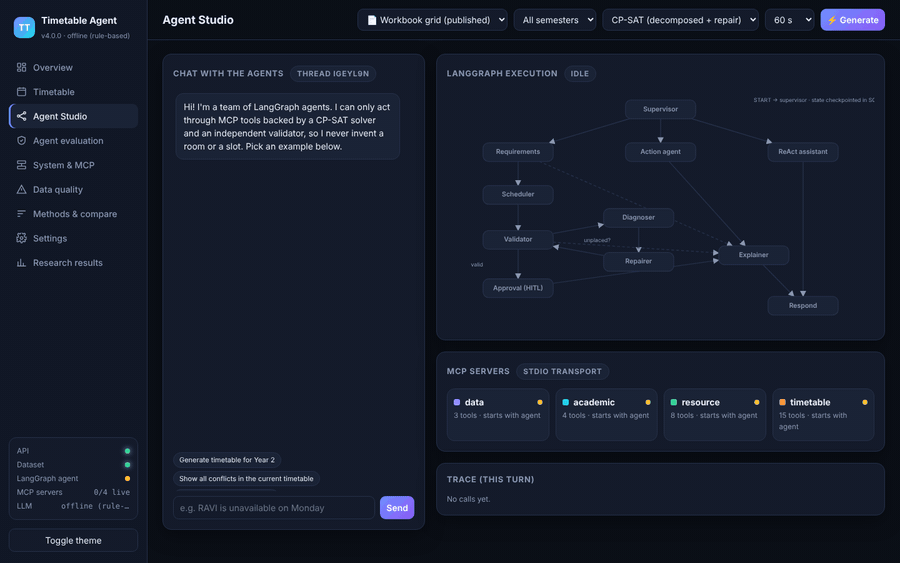
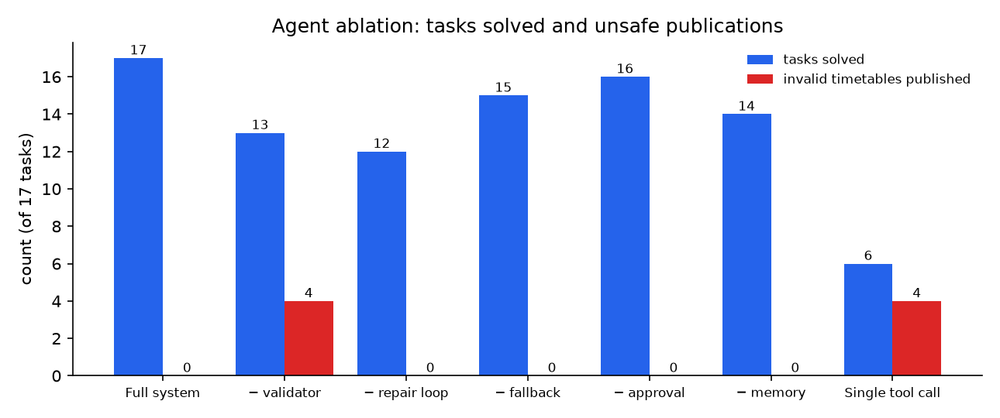
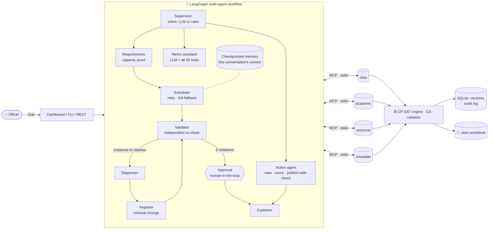
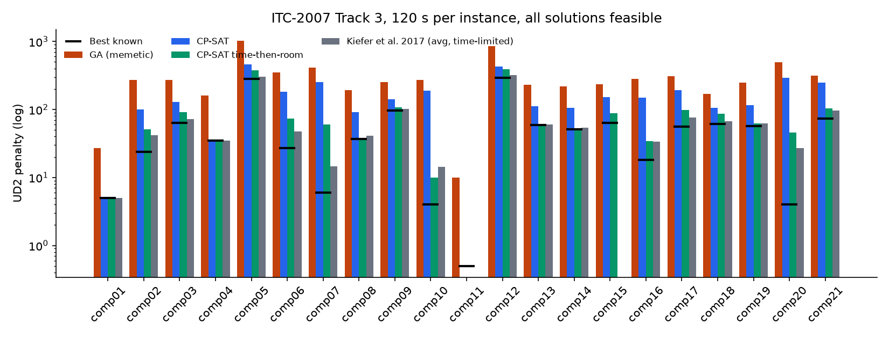
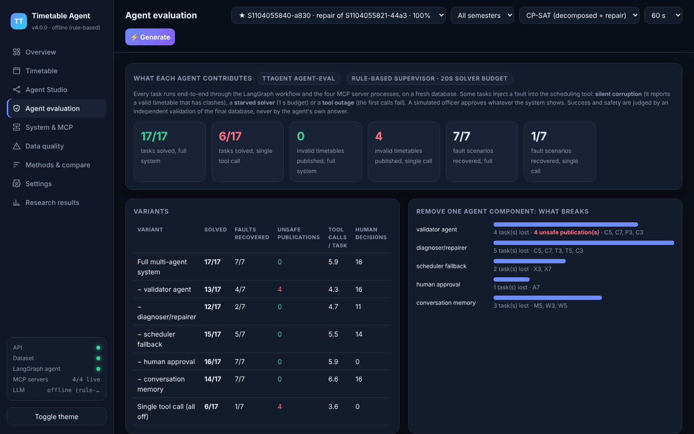

<div align="center">

# 🗓️ University Timetable Agent

**A multi-agent AI system that builds, checks, repairs and explains a real university timetable.
LangGraph agents · Model Context Protocol (MCP) · OR-Tools CP-SAT**


[](https://github.com/Niteshpandey12345/university-timetable-agent/actions/workflows/ci.yml)


| 🤖 **Agents** | 🛡️ **Safety** | 📅 **Real data** | 🧪 **Benchmarks** |
|:-:|:-:|:-:|:-:|
| **17/17** office tasks solved, incl. 7 with a faulty tool | **0** invalid timetables published (single-tool-call baseline: **4**) | **99.85 %** of 674 h/week, **0** clashes (published grid: 98.96 %, 20 clashes) | beats a tuned GA (p = 0.0002); ITC-2007 median gap 106 % → 37.5 % |



🎬 **[Demo: agents catch a faulty tool (1 min)](docs/media/demo_v4.mp4)** · [Full tour (2 min)](docs/media/demo.mp4) · 🤖 **[Agent evaluation](docs/AGENT_EVALUATION.md)** · 📊 [Solver & GA analysis](docs/V3_ANALYSIS.md) · 📄 [Project report (Word)](docs/Project_Report.docx) · 📘 [User guide](docs/USAGE.md) · 🏗️ [Architecture](docs/ARCHITECTURE.md)

</div>

---

## Contents
1. [What it does](#-what-it-does)
2. [Why agents? The measured answer](#-why-agents-the-measured-answer)
3. [How it works](#-how-it-works)
4. [Results on real data and benchmarks](#-results-on-real-data-and-benchmarks)
5. [Quick start](#-quick-start)
6. [Ways to use it](#-ways-to-use-it)
7. [Repository structure](#-repository-structure)
8. [Reproducing the research](#-reproducing-the-research)
9. [FAQ](#-faq)

---

## ✨ What it does

A university's timetable lives in a macro-enabled Excel workbook (`Master_TimeTable_July-Dec-2026.xlsm`).
A VBA macro fills it greedily and staff fix the rest by hand. This project replaces that with a team of
**AI agents** that talk to the timetable only through **typed MCP tools**:

| The officer asks (plain English) | What the agents do |
|---|---|
| *"Generate timetable for semester 3"* | Supervisor → capacity proof → **CP-SAT solver** → **independent validator** → repair loop if needed → **human approval** → explanation |
| *"RAVI is unavailable on Monday"* | Records the constraint → **minimal-change repair** of *this conversation's* version → re-validation → approval |
| *"Why could you not schedule the DBMS lab?"* | For every possible slot: which batch / teacher / room blocks it, and which room change would fix it |
| *"publish it"* | Re-validates first; refuses if anything is broken |
| *"Show timetable of batch 1B1"* · *"compare with the published timetable"* | Weekly grids, side-by-side quality metrics |

**The core rule: the LLM never places a class.** Every allocation comes from the constraint solver and is
re-checked by a validator that shares no code with it. The LLM (optional: Gemini, Claude, OpenAI or a local
model) only understands requests and words the answers; without a key a rule-based supervisor does the same job.

## 🤖 Why agents? The measured answer

A solver alone produces timetables. The agents make it safe to *operate* one: they check the solver's work,
fix what fails, recover when a tool breaks, remember who is working on which version, and ask a human before
anything is published. We measured each of these by switching it off.

**Setup.** 17 realistic tasks, run end-to-end through the real LangGraph workflow and the 4 MCP server
processes. Seven of them inject a fault into the scheduling tool: **silent corruption** (it reports a valid
timetable that has clashes), a **starved solver** (1 s, one core) or a **tool outage**. A simulated officer
approves whatever the system shows. Success is judged by an independent validation of the final database.

| System | Tasks solved | Fault tasks recovered | Invalid timetables published |
|---|:-:|:-:|:-:|
| **Full multi-agent system** | **17/17** | **7/7** | **0** |
| − validator agent | 13/17 | 4/7 | 4 |
| − diagnoser/repairer | 12/17 | 2/7 | 0 |
| − scheduler fallback | 15/17 | 5/7 | 0 |
| − conversation memory | 14/17 | 7/7 | 0 |
| − human approval | 16/17 | 7/7 | 0 |
| Single tool call (no agents) | 6/17 | 1/7 | **4** |



* **Validator agent → safety.** When the tool lied ("0 violations, valid") the single-call system published the
  clashes *and told the user they were valid*. The full system caught every one.
* **Repair loop → recovery.** Corrupted and starved timetables were fixed instead of abandoned.
* **Fallback → resilience.** After a tool outage the scheduler retried and then switched to the GA allocator.
* **Memory → shared use.** With a colleague generating in between, a stateless system repaired or showed
  *someone else's* version.
* **Approval → control.** 16 publications were decided by a human; without the gate a draft was published against
  the officer's decision.

The agents cost about 2 extra tool calls and 4 seconds per request. In what-if requests their minimal-change repair moved 3.6–11.6 % of the semester; the single-call baseline regenerated and moved 78–86 %, of the wrong version. Full method, examples and threats to
validity: **[docs/AGENT_EVALUATION.md](docs/AGENT_EVALUATION.md)**. The same suite runs with an LLM supervisor:
`ttagent agent-eval --llm`.

## 🧩 How it works



| Agent | Role | Measured contribution |
|---|---|---|
| **Supervisor** | Understands the request (LLM structured output, rule-based fallback) and routes it | 92 % action accuracy on 77 held-out phrasings (rules) |
| **Requirements** | Capacity proof and scope; records what-if constraints | answers "is it possible?" from a proof |
| **Scheduler** | Calls the solver; retries and switches to the GA when a call fails | 2 outage tasks recovered |
| **Validator** | Re-validates every result independently; gates repair and publication | 4 corrupted versions stopped |
| **Diagnoser + Repairer** | Explains unplaced sessions; minimal-change LNS repair, also of clashes | 5 broken or starved timetables fixed |
| **Approval** | Human-in-the-loop `interrupt()` before publishing | 16 human decisions; draft veto respected |
| **Action agent** | Single-tool requests (view, move, export…); re-checks before "publish" | refuses broken versions |
| **Explainer** | Template or LLM wording from tool results, with the exact figures attached | – |

| Layer | What it is | LLM? |
|---|---|:-:|
| **Agents** `ttagent/agents` | LangGraph `StateGraph`, 11 nodes, conditional routing, repair loop, `interrupt()` approval, SQLite checkpointer | optional |
| **MCP** `ttagent/mcp_servers` | 4 FastMCP servers (data, academic, resource, timetable), 30 typed tools, every call audited | ❌ |
| **Engine** `ttagent/engine` | Time-then-room **CP-SAT decomposition** with Hall cuts, **LNS repair**, memetic **GA**, VBA-macro port, validator (H1–H9), capacity proof, diagnosis | ❌ |
| **Ingestion** `ttagent/ingestion` | Reads the `.xlsm` exactly as the macro does; learns elective baskets; data-quality report | ❌ |

More detail: [docs/ARCHITECTURE.md](docs/ARCHITECTURE.md).

## 📊 Results on real data and benchmarks

**Real workbook** (348 requirements, 674 h/week, 54 batches, 38 rooms), 10 seeds × 120 s:

| Method | Hours scheduled | Hard violations | Soft penalty / scheduled h |
|---|---:|---:|---:|
| Published grid (VBA macro + manual edits) | 98.96 % | **20** | 4.14 |
| VBA `Allot` macro (faithful port) | 88.13 % | 4 | 4.35 |
| Memetic GA (configuration confirmed by a tuning race) | 98.47 ± 0.70 % | 0 | 4.25 |
| **CP-SAT pipeline (this system)** | **99.85 ± 0.25 %** | **0** | **3.27** |

CP-SAT beats the GA in coverage and soft quality (Mann–Whitney p ≤ 0.0003, Cliff's δ ≈ 0.97, 10 seeds). A
two-stage tuning race (10 random configurations on sub-instances, the best 3 plus the default on the full
instance) kept the hand-set GA configuration. CP-SAT also leads on
6 of 7 instances of a stress-test family derived from the real data (each semester alone, +10 % load, two
lecture theatres closed, three teachers absent); on semester 7 both reach 100 % and the GA has the lower soft
penalty. The pipeline now also works on **one CPU core** (100 % coverage in 128 s via a GA start; v3: no solution).

**ITC-2007 Track 3** (21 public instances, 120 s, 2 cores): the time-then-room decomposition — the same idea
the engine uses on the real data — cuts the median gap to the best-known results from 106 % (plain CP-SAT)
to **37.5 %**, reaches the proven optimum on 5 instances, is at or below the time-limited average of Kiefer et
al. (2017) on 7 of 19, and beats the GA on all 21. It is still behind the dedicated state of the art on the
hardest instances; we report it as evidence that the engine is general and sound, not as a new best result.



Findings from the real data: the macro's model is **provably infeasible** (some batches need 42 h in a 34-h
week); elective baskets learned from the data make it feasible; requested venues must be treated as preferences.

Details: [docs/V3_ANALYSIS.md](docs/V3_ANALYSIS.md) · [docs/RESEARCH_REPORT.md](docs/RESEARCH_REPORT.md) · [project report](docs/Project_Report.docx).

## 🖼️ Screenshots

| Agent Studio: live LangGraph path, MCP calls, approval | Agent evaluation page |
|---|---|
|  |  |
| **Overview** | **Timetable explorer** |
|  |  |

## 🚀 Quick start

**Requirements:** Python 3.10–3.14. No API key is needed.

**Windows, one click:** double-click `TimetableAgent.bat`. It installs everything on first run, loads the workbook
and opens the dashboard. (`./run.sh` on macOS/Linux.)

**Manual:**

```powershell
git clone https://github.com/Niteshpandey12345/university-timetable-agent.git
cd university-timetable-agent
python -m venv .venv
.venv\Scripts\Activate.ps1                # macOS/Linux: source .venv/bin/activate
python -m pip install -e .               # installs the `ttagent` command
ttagent ingest                           # parse the workbook (a few seconds)
ttagent serve                            # → opens http://127.0.0.1:8000
```

In the dashboard open **Agent Studio** and type *"Generate timetable for semester 3"*. To see the safeguards
at work, start the server with a faulty tool: `set TTAGENT_FAULT=corrupt:3` (PowerShell: `$env:TTAGENT_FAULT="corrupt:3"`),
then `ttagent serve`; the validator agent catches the corruption and the repairer fixes it before approval.

> Optional LLM: copy `.env.example` to `.env` and add `GOOGLE_API_KEY` (or `ANTHROPIC_API_KEY`, `OPENAI_API_KEY`).

## 🛠️ Ways to use it

| Command | Purpose |
|---|---|
| `ttagent serve` | Dashboard: Overview, Timetable, **Agent Studio**, **Agent evaluation**, System & MCP, Methods, Settings |
| `ttagent chat --trace` | Chat with the agents in the terminal and see every node and MCP call |
| `ttagent solve --method decomposed\|exact\|ga\|ga_plain\|vba --time 120` | Solve without agents and export to Excel |
| `ttagent agent-eval [--llm]` | The agent evaluation (scenarios × ablations × injected faults) |
| `ttagent benchmark --time 120` | ITC-2007 benchmark (`--only-decomp` adds the decomposition) |
| `ttagent llm-eval` | LLM routing, faithfulness and LLM-only baseline (needs a key) |
| `ttagent mcp-tools` | Start the 4 MCP servers and list their 30 tools |
| Claude Desktop | Use the same MCP servers from Claude: [`docs/claude_desktop_config.example.json`](docs/claude_desktop_config.example.json) |

Step-by-step guide: **[docs/USAGE.md](docs/USAGE.md)** · study with real users: **[docs/USER_STUDY.md](docs/USER_STUDY.md)**.

## 📁 Repository structure

```
├── ttagent/
│   ├── agents/          # LangGraph graph (11 nodes, ablation switches) · agent session · MCP bridge · intent · LLM · render
│   ├── mcp_servers/     # data · academic · resource · timetable (FastMCP, stdio, audited)
│   ├── engine/          # decomposed CP-SAT · exact CP-SAT · LNS repair · GA · VBA port · validator · diagnosis · service
│   ├── benchmarks/      # ITC-2007: parser + UD2 scorer · CP-SAT · decomposition · GA · LNS
│   ├── ingestion/ domain/ store/ export/ api/ cli.py
├── scripts/             # run_agent_eval · report_agent_eval · run_analysis_v3/v4 · run_benchmark_itc · report_itc
│                        # run_llm_eval · analyze_user_study · run_experiments · chat · solve · ingest · run_demo
├── experiments/
│   ├── results/agent_eval/   # agent evaluation (JSON, tables, figures)
│   ├── results/v3/ v4/       # GA comparison, seeds, tuning, instance family
│   ├── results/itc2007_*     # benchmark results
│   └── llm_eval/             # 77 labelled requests
├── data/                # raw workbook · ITC instances · processed dataset · state (SQLite)
├── docs/                # index: docs/README.md · AGENT_EVALUATION · V3_ANALYSIS · ARCHITECTURE · USAGE · USER_STUDY · DEMO · report
├── tests/               # 52 tests (real workbook, ITC-2007, MCP round-trip, agent end-to-end with faults)
├── config/              # settings.yaml · seat/batch-size templates · overrides.yaml (from the Settings page)
└── TimetableAgent.bat · run.sh · pyproject.toml
```

## 🧪 Reproducing the research

```bash
python -m pytest tests -q                           # 52 tests
ttagent agent-eval && python -m scripts.report_agent_eval      # agents (~35 min)
python -m scripts.run_analysis_v3 --time 120        # methods, anytime, repair trade-off, heatmaps
python -m scripts.run_analysis_v4                   # 10 seeds, GA tuning, instance family, one core
ttagent benchmark --time 120 && ttagent benchmark --only-decomp && python -m scripts.report_itc
ttagent llm-eval                                    # with an LLM key
```

## ❓ FAQ

<details><summary><b>Does it need an OpenAI / Gemini / Claude key?</b></summary>

No. Every structured request works offline with the rule-based supervisor, and all results above were produced
that way. A key adds free-form questions, LLM-worded explanations and the LLM part of the evaluation.
</details>

<details><summary><b>Is the agent evaluation "rigged" by the injected faults?</b></summary>

The faults model real failure classes (a buggy or stale tool, a slow machine, an outage, a colleague editing
at the same time, a hand-edited version). Their frequency in practice is unknown, so read the table as
"which component prevents which failure", not as a field reliability rate. See the threats-to-validity section
of [docs/AGENT_EVALUATION.md](docs/AGENT_EVALUATION.md).
</details>

<details><summary><b><code>pip</code> is not recognized / Activate.ps1 is blocked</b></summary>

Use `.venv\Scripts\python.exe -m pip ...`, or run `Set-ExecutionPolicy -Scope Process -ExecutionPolicy Bypass`
in the same terminal before activating. Or just double-click `TimetableAgent.bat`.
</details>

<details><summary><b>Can I use my own institution's workbook?</b></summary>

Yes, if it follows the same layout (requirements in `Main!K:V`, grid in `Main!B2:J301`). Upload it from
**Settings**, or set `TTAGENT_WORKBOOK` and run `ttagent ingest`.
</details>

## 📜 License & citation

MIT; see [LICENSE](LICENSE). Release notes: [CHANGELOG.md](CHANGELOG.md). Citation metadata: [CITATION.cff](CITATION.cff). The workbook in `data/raw/` belongs to the institution and is not covered by the
licence. If you use this work, please cite:

```
Nitesh Pandey (2026). University Timetable Agent: LangGraph multi-agent orchestration over MCP with a
decomposed CP-SAT engine, evaluated on real institutional data. M.Tech Deep Learning project, v4.
```
