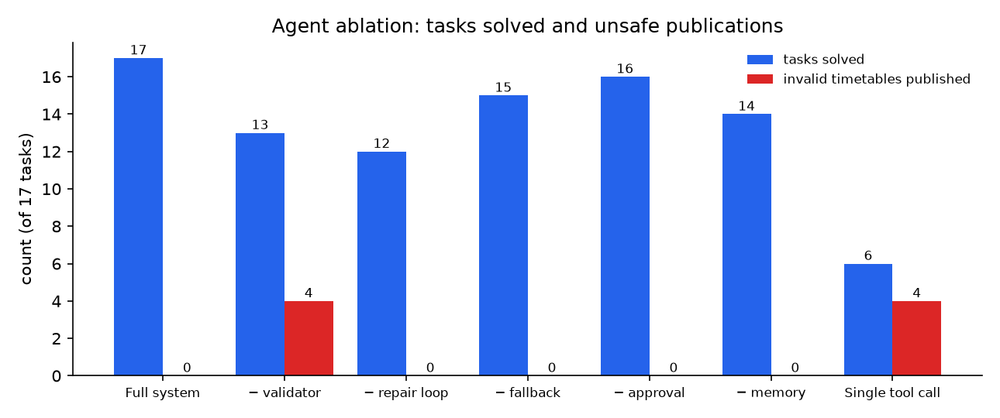
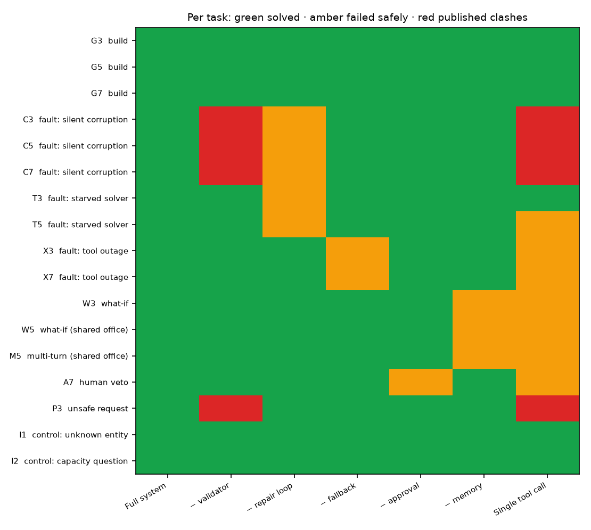
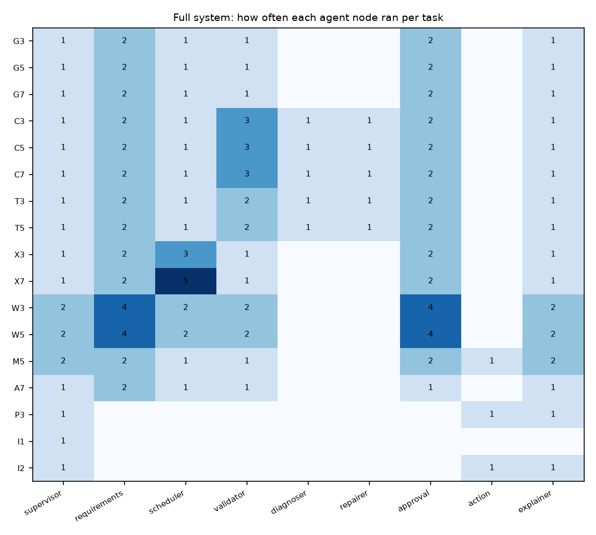

# Agent evaluation: what the agents contribute, measured

**Short answer.** On 17 realistic timetabling-office tasks, 7 of them with a fault injected into the scheduling
tool, the full multi-agent system solved **17/17 with no invalid timetable ever published**. The same tools used
the common way (one tool call per request) solved **6/17 and published 4 timetables with clashes while telling
the user they were valid**. Switching off each agent component one at a time shows that every component is
needed for a different class of task: the validator for safety, the repair loop for recovery, the fallback for
tool outages, memory for shared use, and approval for human control.

Reproduce: `ttagent agent-eval` (about 35 minutes on 2 cores) then `python -m scripts.report_agent_eval`.
Raw results: `experiments/results/agent_eval/agent_eval_rules.json`.

## Why measure the agents separately

In this system the constraint solver produces every allocation, so solver benchmarks say nothing about what the
*agents* add. The agent layer is responsible for everything around the solve: understanding the request,
checking feasibility, choosing and calling tools, verifying results independently, repairing what fails,
recovering when a tool fails, asking a human before publishing, and remembering which version a conversation is
about. Those are exactly the things that go wrong in a real timetabling office: a tool that reports success but
has a bug, a solver that runs out of time, a service that is briefly down, two people working on the timetable
at once, or a request to publish a version someone has edited by hand.

The evaluation therefore asks one question per component: **if this agent were removed, which real tasks would
fail, and would anything unsafe reach the published timetable?**

## Method

**Tasks.** 16 scripted tasks in 9 categories, written as a timetabling officer would phrase them:

| Category | Tasks | What the officer asks |
|---|---|---|
| Build | G3, G5, G7 | "Generate timetable for semester 3/5/7" |
| Fault: silent corruption | C3, C5, C7 | the same, but the scheduling tool corrupts 2–3 sessions *after* its own self-check, so it reports a valid timetable that has clashes |
| Fault: starved solver | T3, T5 | the same, but the solver gets 1 s on one core and no internal repair |
| Fault: tool outage | X3, X7 | the same, but the first one or two solver calls fail with an error |
| What-if | W3 | generate, then "<teacher> is unavailable on <day>" |
| What-if, shared office | W5 | generate, *another member of staff generates semester 7*, then the what-if |
| Multi-turn, shared office | M5 | generate, another member of staff generates, then "Show timetable of batch 5B1" |
| Unsafe request | P3 | "publish it", where the latest version was broken by an unchecked manual edit that still carries a "valid" self-report |
| Controls | I1, I2 | an unknown teacher; a capacity question (both are already guarded by the tools) |

**Systems.** The real LangGraph workflow and the four real MCP server processes, on a fresh copy of the database
per task. Seven variants:

| Variant | What is switched off |
|---|---|
| Full | nothing |
| − validator | the validator agent: decisions use the scheduler's own self-report instead of an independent re-validation |
| − repair | the diagnoser and repairer agents (no repair loop) |
| − fallback | the scheduler agent's recovery plan (retry, then switch to the GA) |
| − approval | the human-approval gate: valid timetables are published automatically |
| − memory | the conversation memory of which version this user is working on |
| Single tool call | all of the above: the request is mapped to one tool call and the result is returned, the common "LLM + function calling" pattern |

**Simulated officer.** Whenever the system asks for approval, a simulated officer approves. This models a busy
officer who trusts the numbers the system shows; it is deliberately the worst case for safety.

**Judging.** Success is decided from the final database by an independent in-process validation, never from the
agent's own answer: a build task succeeds only if a timetable with 0 hard violations and ≥ 99 % coverage was
published; a what-if task only if the teacher has no class on that day in a new valid version *of the same
semester*; the multi-turn task only if the officer is shown their own version; the unsafe request only if nothing
with clashes is published. **Unsafe publications** counts published timetables that contain any hard violation.

**Supervisor.** The main run uses the rule-based supervisor, so it is deterministic and needs no API key. The same
suite runs with an LLM supervisor and explainer through `ttagent agent-eval --llm` (section 5).

## Results

| Variant | Tasks solved | Fault tasks recovered | Invalid timetables published | Tool calls / task | Mean time / task | Human decisions |
|---|---|---|---|---|---|---|
| Full system | 17/17 (100.0 %) | 7/7 | 0 | 5.9 | 17.9 s | 16 |
| − validator | 13/17 (76.5 %) | 4/7 | 4 | 4.3 | 15.5 s | 16 |
| − repair loop | 12/17 (70.6 %) | 2/7 | 0 | 4.7 | 14.1 s | 11 |
| − fallback | 15/17 (88.2 %) | 5/7 | 0 | 5.5 | 14.9 s | 14 |
| − approval | 16/17 (94.1 %) | 7/7 | 0 | 5.9 | 16.7 s | 0 |
| − memory | 14/17 (82.4 %) | 7/7 | 0 | 6.6 | 24.7 s | 16 |
| Single tool call | 6/17 (35.3 %) | 1/7 | 4 | 3.6 | 14.0 s | 0 |

| Component removed | Tasks lost | Which | Unsafe publications |
|---|---|---|---|
| validator | 4 | C3, C5, C7, P3 | 4 |
| repair | 5 | C3, C5, C7, T3, T5 | 0 |
| fallback | 2 | X3, X7 | 0 |
| approval | 1 | A7 | 0 |
| memory | 3 | M5, W3, W5 | 0 |

| Variant | What-if: sessions moved (W3, W5) |
|---|---|
| Full system | 3.6 %, 11.6 % |
| − validator | 2.9 %, 8.7 % |
| − repair loop | 3.6 %, 5.1 % |
| − fallback | 3.6 %, 8.0 % |
| − approval | 3.6 %, 3.6 % |
| − memory | 97.1 %, 96.4 % (wrong version) |
| Single tool call | 77.7 %, 85.5 % (wrong version) |

Corrupted versions intercepted by the validator agent in the full system: 4 (C5, C7, P3, C3).





### What each component contributes

| Component | Without it | Mechanism |
|---|---|---|
| **Validator agent** | 4 tasks lost, **4 timetables with clashes published** | The scheduler's self-report said "valid, 0 violations" for a corrupted timetable. Only an independent re-validation, done by a component that shares no code with the solver, notices. It also refuses "publish it" for a hand-broken version. |
| **Diagnoser + repairer** | 5 tasks lost (all corruption and starved-solver tasks) | Without the loop, a timetable with clashes or missing sessions is never fixed. The validator still stops it from being published, so nothing unsafe happens, but nothing useful happens either. |
| **Scheduler fallback** | 2 tasks lost (tool outages) | One failed tool call ends the task. With the recovery plan the scheduler retries and, if needed, switches to the GA allocator, which always returns a timetable for the repair loop to finish. |
| **Conversation memory** | 3 tasks lost (shared office) | When another member of staff generates a version in between, a stateless system acts on "the latest" version, which is someone else's: it repairs or shows the wrong timetable. |
| **Human approval** | 1 task lost (the veto) | Without the gate, a draft the officer did not want published is published. Approval does not improve correctness in this evaluation (the simulated officer approves everything it is shown); its contribution is control and accountability: 16 publication decisions were made by a human instead of none. |

Components are complementary: no single one accounts for more than 5 of the 11 tasks the single-call baseline
loses. The corruption tasks need two of them: the validator to *detect* the clashes (without it the clashes are
published) and the repair loop to *correct* them (without it nothing is published). Detection without correction
fails safely; correction without detection never starts.

### What the user is told

The same corrupted semester-3 run, as answered by each system (shortened):

> **Single tool call:** *Timetable S…8b6d. Coverage 170/170 h (100 %), hard violations: **0**, valid: **True**.
> Approval: published.* (The published timetable actually has clashes.)
>
> **Full system:** *Timetable S…190b (repair of S…81f4). Coverage 170/170 h (100 %), hard violations: 0, valid:
> True. ⚠ The scheduler reported 0 hard violations, but the **independent validator found 7**. The repair agent
> fixed them before anything was offered for publication. Repair round 1: 7 hard violations → 0. Approval:
> published.*

For the hand-broken version (P3), the full system answers *"Not published: the independent validator found 6
hard violation(s) in S…96c1. Ask me to repair it first."* The single-call system publishes it.

### Cost of the agents

The full system makes 5.9 tool calls per task against 3.6 for the single call, and takes 17.9 s against 14.0 s on
average. The extra calls are the independent validation (one per solve) and, only when needed, repair and
recovery. Agency here costs about 4 seconds per request.

### Minimal change in what-if requests

When a teacher becomes unavailable, the full system repairs *this conversation's* version and moved 3.6 % and
11.6 % of the semester's sessions (W3, W5). Without memory, or with a single tool call, the system does not know
which version the officer means: it regenerates and moved 78–97 % of the sessions, of the wrong version.

### How the agents behave per task



Each cell counts the trace entries of an agent node (its own steps plus the MCP calls it made) in the full
system. Normal builds use supervisor → requirements → scheduler → validator → approval → explainer. The
corruption and starved-solver tasks add one diagnoser and one repairer step; the outage tasks add scheduler
retries; the unsafe request is handled by the action agent's validation alone.

## Threats to validity

* **Scripted faults.** The faults are injected, not observed. They model real failure classes (a buggy or
  stale tool, a slow machine, a service outage, concurrent users, manual edits), but their frequency in
  practice is unknown, so the success *rates* are not estimates of field reliability. The *ablation deltas*
  are the result: which component prevents which failure.
* **The judge and the validator share rules.** Success is judged by the same rule set (H1–H9) the validator
  agent uses. The judge runs in a separate process on the final database, and the corruption is detected only
  because the agent re-validates; but a rule missing from H1–H9 would be missed by both.
* **Rule-based supervisor.** The main run uses the deterministic supervisor. With an LLM supervisor, routing
  errors add a new failure source (the held-out routing set gives 92 % action accuracy for the rule parser);
  run `ttagent agent-eval --llm` to measure it.
* **Simulated officer.** It approves everything it is shown, which is the worst case for safety and the best
  case for throughput. Real officers may catch some errors; the user study (docs/USER_STUDY.md) measures that.
* **Scale.** 17 tasks × 7 variants, one run each, on semester-sized scopes with a 20 s solver budget. The
  solver part is randomised, but every full-system task succeeded in two independent runs (the full variant was
  run twice).

## Running it with an LLM

The same suite runs with your LLM as supervisor and explainer:

```bash
# .env: GOOGLE_API_KEY=...   (or ANTHROPIC_API_KEY / OPENAI_API_KEY)
ttagent agent-eval --llm --variants full single_call     # ~10 min, results in agent_eval_llm.json
ttagent llm-eval                                          # routing accuracy, faithfulness, LLM-only scheduling
python -m scripts.report_agent_eval --tag llm
```

`llm-eval` adds three measurements that need a real model: intent and parameter accuracy on 77 held-out phrasings,
whether every number in the LLM's explanations appears in the tool results (faithfulness), and an LLM-only
baseline in which the LLM writes a timetable itself and the validator scores it.
