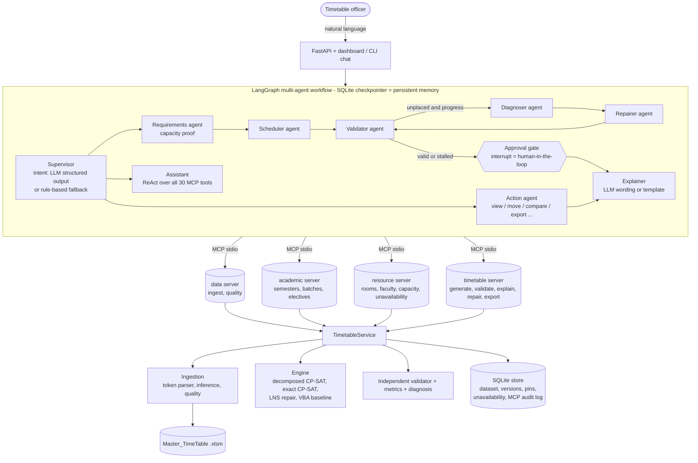

# Architecture

## Layers

| Layer | Package | Responsibility | LLM? |
|---|---|---|---|
| Ingestion | `ttagent/ingestion` | Read `Main!K:V` (requirements) and `Main!B2:J301` (grid) exactly as the VBA does; parse tokens; infer rooms, placeholders, elective baskets, external bookings, reference schedule; data-quality report | no |
| Domain | `ttagent/domain` | Pydantic models, time grid rules (lunch, Saturday cut-off, lab blocks), room-suitability policy | no |
| Engine | `ttagent/engine` | CP-SAT models, LNS repair, VBA port, validator, metrics, capacity proof, diagnosis, service facade | no |
| Store | `ttagent/store` | SQLite (WAL) shared by every MCP process: dataset, solution versions, pins, unavailability, audit | no |
| MCP | `ttagent/mcp_servers` | 4 FastMCP stdio servers, 30 typed tools, 2 resources, 1 prompt; every call audited | no |
| Agents | `ttagent/agents` | LangGraph state machine, MCP bridge, intent parsing, prompts, renderers | yes (optional) |
| API | `ttagent/api` | REST + dashboard + chat with approval | no |

## The hard boundary

The LLM can **request** a timetable, **inspect** it and **explain** it. It cannot place
a session: the only code paths that write assignments are `generate_timetable`,
`repair_timetable` and `move_session`, and all three go through the CP-SAT engine
and the independent validator. `move_session` refuses to commit a move that breaks
a hard rule.

## Solver design

**Stage 1 - time assignment** (`engine/decomposed.py`): booleans `y[s,d,t]` only.
Room feasibility is kept by Hall-type cuts per room pool and capacity threshold.
It is solved lexicographically: maximise placed hours, then minimise the soft
penalty subject to "placed hours ≥ optimum of phase 1".

**Stage 2 - room assignment**: a matching over all suitable rooms. It minimises
room changes against the requested venue and avoids over-sized rooms.

**Repair** (`engine/repair.py`): Large Neighbourhood Search. It frees the
sessions most likely to block the problem ones (same batch > same teacher >
same venue), freezes everything else, and re-solves. Each rung escalates:
exact model on 60 sessions → decomposed model on 320 sessions → allow the
16:00 slot, with one re-seeded retry. Repairs are **minimal-perturbation**:
each moved session pays a penalty, so a what-if changes as little as possible.

**Electives**: a session of basket K blocks only its *own* batches. Sessions
of the same basket may overlap in time for shared batches. Sessions of
different baskets, and core courses, may not.

## Hard rules (validator)

| Rule | Meaning |
|---|---|
| H1 batch clash | a batch in two places at once (same-basket electives exempt) |
| H2 faculty clash | a real teacher in two places (HSS*/OTH*/RSCH*/ECE* placeholders exempt) |
| H3 room clash | two sessions in one room |
| H4 lunch | anything in slot 5 (13:00-14:00) |
| H5 outside hours | outside slots 1-4, 6-7 (8 only if the extended policy was used); Saturday after 13:00 |
| H6 block integrity | 2-hour labs contiguous, never across lunch |
| H7 same-day repeat | a requirement meets at most once per day |
| H8 room suitability | right category, lab type and capacity |
| H9 availability | faculty / batch / room unavailability |

`X_*` codes flag problems inside **external** bookings (BBA, MCA, ...).
They are reported but not counted against our timetable.

## Persistence & memory

* `data/state/timetable.db` stores the dataset, every timetable version with
  its parent (a lineage of edits and repairs), pins, unavailability, and the
  MCP audit log.
* `data/state/agent_memory.db` is the LangGraph checkpoint per `thread_id`.
  Conversations, and a pending approval, survive a restart.
