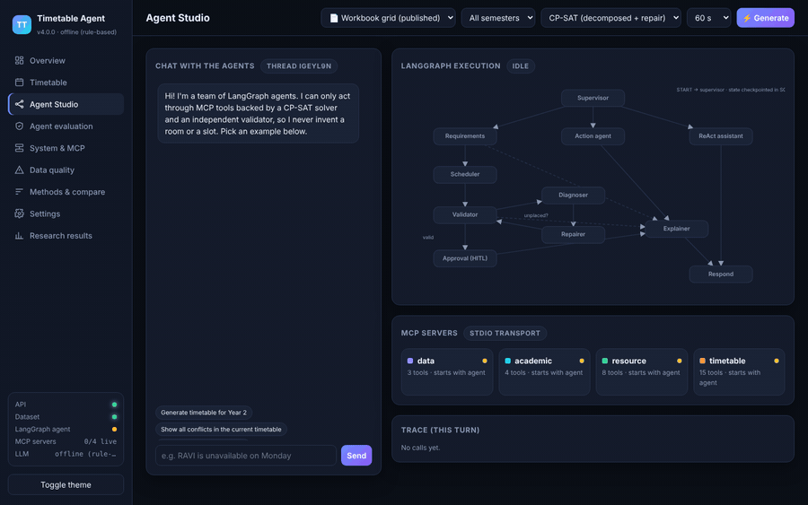

# Demo

🎬 **Video:** [`media/demo.mp4`](media/demo.mp4) (2 min 9 s, recorded from the dashboard, offline mode, no LLM key)



## What the video shows

| Time | Scene | What to notice |
|---|---|---|
| 0:00 | Overview | 674/674 h scheduled, 0 hard violations; live comparison bars vs the published workbook grid |
| 0:15 | Timetable explorer | batch `1B1` and faculty `RAVI` weekly grids; lecture / tutorial / lab colours |
| 0:25 | System & MCP | **Connect** spawns 4 MCP servers over stdio; all 30 tools are discovered from their schemas |
| 0:40 | Agent Studio: *"Generate timetable for Year 2"* | supervisor → requirements (capacity proof) → scheduler → validator; MCP cards flash; **human-in-the-loop approval** pauses the graph |
| 1:05 | *"JP is unavailable on Tuesday"* | constraint recorded → minimal-change repair → re-validation → approval |
| 1:30 | *"Compare with the published timetable"* | an answer grounded in tool results |
| 1:40 | Data quality | 7 learned elective baskets; the macro's strict model is provably infeasible |
| 1:55 | Research results | the experiment figures |

## Re-record it yourself

```powershell
uvicorn ttagent.api.main:app
python -m scripts.run_demo --seconds 60     # terminal version of the same story, with full MCP trace
```

## Viva script (5 minutes)

1. **Problem.** The VBA macro leaves 40 requirements unscheduled. Show **Data quality → Capacity proof**:
   the macro's model is mathematically impossible (sem-7 needs 42 h in a 34-h week).
2. **Insight.** Electives are parallel in practice; the system learns these 7 baskets from the published grid.
3. **Architecture.** Show **System & MCP**: the LLM only reaches the timetable through 30 typed MCP tools.
   The solver produces allocations and an independent validator checks them.
4. **Live run.** In Agent Studio, send *"Generate timetable for Year 2"*. Point at the graph path, the MCP
   trace, and the approval interrupt.
5. **Robustness.** Send *"JP is unavailable on Tuesday"*. Only the affected sessions move.
6. **Evidence.** Show **Research results**: 99.85–100 % vs 88 % (macro), with 0 vs 20 hard violations.
