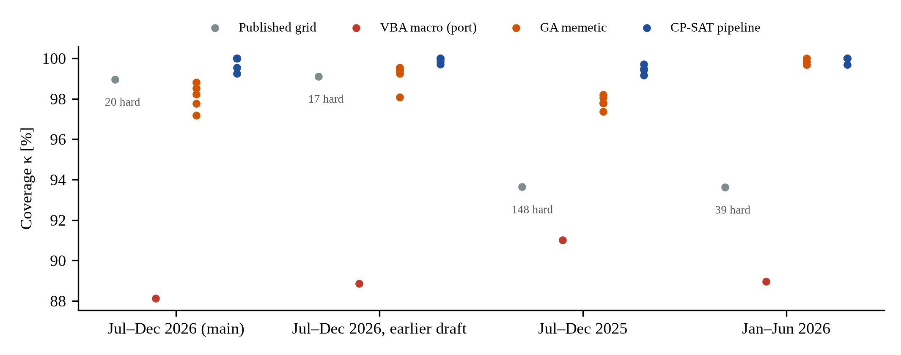

# Multi-term validation: the model on other timetables of the institution

The system was developed on one workbook (July–December 2026, version of 23 July). To test whether the results
hold beyond it, the **unchanged** pipeline was run on three further workbooks of the same institution:

| Term | Workbook | Why it matters |
|---|---|---|
| Jul–Dec 2026, 15 July | earlier draft of the main term | same requirements, different hand edits: tests stability across versions |
| Jul–Dec 2025 | previous year, odd semesters (1, 3, 5, 7) | a different instance: 373 requirements, 723 h/week, 52 rooms |
| Jan–Jun 2026 | even semesters (2, 4, 6, 8) | different courses, cohorts and electives |

Nothing was tuned for the new terms: the same parser, basket inference, solver settings (120 s, 8 workers),
GA configuration and validator were used. Reproduce:

```bash
python -m scripts.run_multiterm --workbooks jul2025=<path> jan2026=<path> jul2026_v15=<path> --seeds 5 --time 120
python -m scripts.report_multiterm
```

Results: `experiments/results/multiterm/`.

## 1. The workbooks parse and the diagnosis generalises

All three workbooks parsed with the same reader (the layout is identical across terms).

| Term | Requirements | Hours/week | Rooms | Teachers | Batches over capacity (macro model) | Macro hours missing | Published coverage [%] | Published hard violations [count] |
|---|---:|---:|---:|---:|---:|---:|---:|---:|
| Jul–Dec 2026 (main) | 348 | 674 | 38 | 78 | 23 | 84 | 98.96 | 20 |
| Jul–Dec 2026, earlier draft | 348 | 674 | 38 | 78 | 23 | 84 | 99.11 | 17 |
| Jul–Dec 2025 | 373 | 723 | 52 | 85 | 12 | 60 | 93.64 | 148 |
| Jan–Jun 2026 | 340 | 643 | 40 | 84 | 0 | 66 | 93.62 | 39 |

* **The macro's model is provably infeasible in both odd terms** (23 batches over the 34-hour week in 2026, 12 in
  2025): rows are bound to stay unscheduled whatever the order. In the even term it is not infeasible, yet the
  macro still leaves 66 hours unscheduled, because its greedy first-fit order blocks itself.
* **Every published timetable contains hard violations.** Under the strict encoding the counts are 17–148. They
  were classified to separate genuine errors from encoding artefacts:

| Term | Hard violations (strict) | Certainly genuine | Parallel sections of one course | Cohort-wide rows of different courses (possible electives) |
|---|---:|---:|---:|---:|
| Jul–Dec 2026 (main) | 20 | 19 | 1 | 0 |
| Jul–Dec 2026, earlier draft | 17 | 17 | 0 | 0 |
| Jul–Dec 2025 | 148 | 33 | 24 | 91 |
| Jan–Jun 2026 | 39 | 38 | 1 | 0 |

"Certainly genuine" covers teacher, room, lunch, teaching-hours and Saturday violations and batch clashes between
unrelated rows. In the 2025 workbook, sections of one course for the whole semester-7 cohort (e.g. AWN, taught in
parallel in four lecture theatres) and some cohort-wide elective rows each list all 14 batches, so staff placing
them together is probably legitimate; the basket inference found only 3 baskets there (medium confidence), so a
coordinator should confirm the rest in `electives.yaml`. Even so, **17–38 certainly genuine violations remain in
every published timetable.**

## 2. Solver results on all four terms (5 seeds, 120 s)

| Term | Method | Runs | Coverage κ [%] | Hard violations [count] | Φ̂ [pts h⁻¹] |
|---|---|---:|---:|---:|---:|
| Jul–Dec 2026 (main) | Published grid | 1 | 98.96 | 20 | 4.14 |
| Jul–Dec 2026 (main) | VBA macro (port) | 1 | 88.13 | 4 | 4.35 |
| Jul–Dec 2026 (main) | GA memetic | 5 | 98.10 ± 0.64 | 0 | 4.34 |
| Jul–Dec 2026 (main) | CP-SAT pipeline | 5 | 99.76 ± 0.34 | 0 | 3.38 |
| Jul–Dec 2026, earlier draft | Published grid | 1 | 99.11 | 17 | 4.14 |
| Jul–Dec 2026, earlier draft | VBA macro (port) | 1 | 88.87 | 4 | 4.32 |
| Jul–Dec 2026, earlier draft | GA memetic | 5 | 99.14 ± 0.61 | 0 | 4.10 |
| Jul–Dec 2026, earlier draft | CP-SAT pipeline | 5 | 99.91 ± 0.13 | 0 | 2.74 |
| Jul–Dec 2025 | Published grid | 1 | 93.64 | 148 | 5.04 |
| Jul–Dec 2025 | VBA macro (port) | 1 | 91.01 | 0 | 4.15 |
| Jul–Dec 2025 | GA memetic | 5 | 97.84 ± 0.32 | 0 | 4.19 |
| Jul–Dec 2025 | CP-SAT pipeline | 5 | 99.45 ± 0.19 | 0 | 2.92 |
| Jan–Jun 2026 | Published grid | 1 | 93.62 | 39 | 4.91 |
| Jan–Jun 2026 | VBA macro (port) | 1 | 88.96 | 10 | 4.50 |
| Jan–Jun 2026 | GA memetic | 5 | 99.81 ± 0.13 | 0 | 4.15 |
| Jan–Jun 2026 | CP-SAT pipeline | 5 | 99.94 ± 0.14 | 0 | 3.32 |

Mann–Whitney tests, CP-SAT vs memetic GA (two-sided; Cliff's δ):

- Jul–Dec 2026 (main): coverage p = 0.011 (δ = 1.0), Φ̂ p = 0.0079 (δ = -1.0)
- Jul–Dec 2026, earlier draft: coverage p = 0.011 (δ = 1.0), Φ̂ p = 0.0079 (δ = -1.0)
- Jul–Dec 2025: coverage p = 0.011 (δ = 1.0), Φ̂ p = 0.0079 (δ = -1.0)
- Jan–Jun 2026: coverage p = 0.17 (δ = 0.52), Φ̂ p = 0.0079 (δ = -1.0)


* **CP-SAT is the best method in every term**: highest coverage, zero hard violations, and the lowest normalised
  soft penalty Φ̂ with every run better than every GA run (δ = −1, p = 0.008 in all four terms).
* **Coverage advantage**: significant in three terms (δ = 1.0, p = 0.011). In Jan–Jun 2026 both methods reach
  99.8–100 % and the difference is not significant (p = 0.17): when an instance is easy the GA catches up on
  coverage but not on quality (Φ̂ 4.15 vs 3.32 pts h⁻¹, 2.8× more room changes).
* **The macro** reaches 88–91 % in every term; with the published timetables at 93.6–99.1 % and always with genuine
  violations, the gap between current practice and the solver holds across terms.
* **Stability across versions**: the two drafts of the 2026 term give the same picture (CP-SAT 99.76 % vs 99.91 %).
* **The stricter 2025 encoding** (cohort-wide parallel rows treated as clashes by the solver) still yields 99.45 %.



## 3. The agent evaluation on the other terms

The 17 tasks of the agent evaluation (docs/AGENT_EVALUATION.md) were made term-independent: task IDs name roles,
so "3", "5" and "7" are the 2nd, 3rd and 4th semester of the term (4, 6 and 8 in the even term), and the teachers
and batches used in the what-if and look-up tasks are picked from each workbook's own data. All seven variants were
run on the Jan–Jun 2026 and Jul–Dec 2025 terms, each on its own isolated database.

| Variant | Jul–Dec 2026 (main, rep. 1) | Jan–Jun 2026 | Jul–Dec 2025 | Pooled: solved [runs] | 95 % CI [%] | Unsafe [count] | Exact McNemar p |
|---|---|---|---|---|---|---|---|
| Full system | 17/17 (UP 0) | 17/17 (UP 0) | 17/17 (UP 0) | 51/51 | 93.0–100.0 | 0 | – |
| − validator | 13/17 (UP 4) | 13/17 (UP 4) | 13/17 (UP 3) | 39/51 | 63.2–86.0 | 11 | 0.00049 |
| − repair loop | 12/17 (UP 0) | 13/17 (UP 0) | 10/17 (UP 0) | 35/51 | 55.0–79.7 | 0 | 3.1e-05 |
| − fallback | 15/17 (UP 0) | 15/17 (UP 0) | 15/17 (UP 0) | 45/51 | 76.6–94.5 | 0 | 0.031 |
| − memory | 14/17 (UP 0) | 14/17 (UP 0) | 14/17 (UP 0) | 42/51 | 69.7–90.4 | 0 | 0.0039 |
| − approval | 16/17 (UP 0) | 16/17 (UP 0) | 16/17 (UP 0) | 48/51 | 84.1–98.0 | 0 | 0.25 |
| Single tool call | 6/17 (UP 4) | 7/17 (UP 4) | 4/17 (UP 3) | 17/51 | 22.0–47.0 | 11 | 1.2e-10 |

UP = unsafe publications (published timetables with hard violations). The pooled columns combine the three terms
(51 task runs per variant); the main term contributes its first repetition.

Tasks lost against the full system:

| Variant | Jul–Dec 2026 (main, rep. 1) | Jan–Jun 2026 | Jul–Dec 2025 |
|---|---|---|---|
| − validator | C3, C5, C7, P3 | C3, C5, C7, P3 | C3, C5, C7, P3 |
| − repair loop | C3, C5, C7, T3, T5 | C3, C5, C7, T3 | C3, C5, C7, G3, T3, T5, X3 |
| − fallback | X3, X7 | X3, X7 | X3, X7 |
| − memory | M5, W3, W5 | M5, W3, W5 | M5, W3, W5 |
| − approval | A7 | A7 | A7 |
| Single tool call | A7, C3, C5, C7, M5, P3, T5, W3, W5, X3, X7 | A7, C3, C5, C7, M5, P3, W3, W5, X3, X7 | A7, C3, C5, C7, G3, M5, P3, T3, T5, W3, W5, X3, X7 |

* **The full system completed all 51 task runs across three terms and never published an invalid timetable.**
* **The component attribution replicates exactly.** In every term the validator ablation loses the three
  corruption tasks and the unsafe publish request, the fallback ablation the two outage tasks, the memory ablation
  the three shared-office tasks, and the approval ablation the veto.
* **The repair loop matters more on harder instances.** On Jul–Dec 2025, the largest and most constrained term,
  removing it also loses an ordinary build (G3) and an outage task, because the 20 s solver call alone does not
  place everything; the full system's repair loop completes them.
* **The single-tool-call baseline** completed 4–7 of 17 tasks per term and published 11 timetables with clashes
  in total, while reporting them as valid (pooled exact McNemar p = 1.2 × 10⁻¹⁰).

## 4. Threats to validity

* The terms come from one institution with the same workbook layout; a second institution remains future work.
* The 2025 workbook encodes some parallel sections and electives as cohort-wide rows; the basket inference found
  only three baskets there. The solver therefore solved a stricter problem than the staff did, which makes its
  result conservative, but the published-grid violation count must be read with the breakdown in section 1.
* The earlier draft of the 2026 term is not independent of the main term; it tests stability across versions only.

The workbooks of the other terms are not committed to the repository (institutional data). To reproduce, place
them anywhere and pass their paths to `scripts/run_multiterm.py`; for the agent evaluation, ingest each into its
own state folder (`TTAGENT_STATE_DIR`, `TTAGENT_PROCESSED_DIR`) and set `TTAGENT_EVAL_BASE_DB` and `TTAGENT_WORKBOOK`.
