# Abstract

University course timetabling is a classic NP-hard combinatorial problem [1][2]. The institution studied
here solves it with a macro-enabled Excel workbook. A VBA macro (`Allot`) fills a weekly grid greedily, and
staff then fix the result by hand. This project replaces that process with an **agentic AI system**. A team
of Large-Language-Model (LLM) agents, orchestrated as a **LangGraph** state machine, interacts with the
timetable only through typed tools exposed by four **Model Context Protocol (MCP)** servers. Those servers
wrap a deterministic **OR-Tools CP-SAT** constraint engine and an independent validator. The LLM decides
*what* to ask and *how* to explain the answer; it never places a class itself.

Evaluated on the institution's real July–December 2026 workbook (348 requirement rows, 674 teaching
hours/week, 54 batches, 38 rooms, 78 faculty codes), the study makes four findings.

1. **The macro's model is provably infeasible.** Under its "no shared batch may overlap" rule, 23 batches
   need more hours than a week contains, which explains why it always leaves 40 rows (84 h) unscheduled.
2. **Two modelling corrections recovered from the data make the problem solvable:** parallel elective
   baskets learned from human co-scheduling, and room choice instead of fixed venues.
3. **A time-then-room CP-SAT decomposition with Large-Neighbourhood-Search repair schedules 99.85–100 %
   of hours with zero hard-constraint violations.** The published hand-edited grid reaches 98.96 % with
   20 violations, and the macro alone reaches 88.13 %.
4. **Minimal-perturbation repair absorbs a teacher's sudden unavailability by moving only 0.5–7.2 % of
   sessions.**

Version 3 adds a memetic genetic algorithm as a comparison method. Over 5 seeds, CP-SAT beats it in every
run on both coverage (99.76 % vs 98.10 %) and soft quality (Mann–Whitney p < 0.012, Cliff's δ = 1). The same
ranking holds on all 21 instances of the public ITC-2007 curriculum-based benchmark, where CP-SAT also proves
three instances optimal, although both methods remain well behind the state of the art at a 120 s budget.

The system includes a web dashboard that visualises the agent graph and every MCP call live, a
human-in-the-loop approval step, persistent conversational memory, Excel/iCalendar export, a one-command
installer and launcher, 45 automated tests and a reproducible experiment suite.

**Keywords:** agentic AI, LangGraph, Model Context Protocol, constraint programming, CP-SAT, university
course timetabling, large neighbourhood search, genetic algorithm, ITC-2007, explainable AI, human-in-the-loop.

<!-- pagebreak -->

# 1. Introduction

## 1.1 Problem statement

Every semester, a university must assign each weekly teaching session (lecture, tutorial or laboratory)
of every batch to a day, a time slot and a room, with a teacher. No batch, teacher or room may be in two
places at once. Lunch must stay free, laboratories need contiguous two-hour blocks, Saturday afternoons
are off, and rooms must be suitable. This is the *university course timetabling problem* (UCTP), studied
for decades and known to be NP-hard [1][3].

At the institution studied here, the timetable is produced in `Master_TimeTable_July-Dec-2026.xlsm`:

* the requirement table (`Main!K:V`) lists 348 *tokens*: batches, course, type, hours, venue,
  faculty and weekly frequency;
* a VBA macro (`Module2.Allot`) scans the 6-day × 9-slot grid (`Main!B2:J301`) and places tokens
  greedily, first-fit;
* tokens it cannot place are flagged red. Staff then inspect a "Conflict Report" sheet (produced by
  `conflict_report` / `findSafeHaven`) and edit the grid by hand.

## 1.2 Motivation

This process has four weaknesses:

* **Incomplete:** the macro leaves 40 requirements (84 h) unscheduled every time.
* **Error-prone:** the hand-edited grid that was finally published still contains double-booked
  teachers, a batch in two places at once, and 15 classes outside teaching hours.
* **Opaque:** nobody can say *why* a session will not fit, or whether it *can* fit at all.
* **Rigid:** a single teacher's absence means editing cells by hand and hoping nothing else breaks.

## 1.3 Objectives

1. Build a prototype **agentic system** in which LLM agents *orchestrate* tool calls, while a
   deterministic constraint engine performs *all* scheduling. The LLM must never invent a room, slot or
   assignment.
2. Expose the engine through the **Model Context Protocol** so that any MCP-capable agent or client can
   use it (custom LangGraph agents, Claude Desktop, etc.).
3. Run on the **real workbook**, not sample data, and quantify the improvement over the existing
   Excel/VBA process.
4. Make every decision **explainable**: capacity proofs, blocker analysis, validated reports, a live
   execution trace and a human approval step.

## 1.4 Report organisation

Section 2 reviews related work. Section 3 analyses the existing Excel/VBA system and Section 4 the real
data. Sections 5–9 describe the proposed system: architecture, agents, MCP servers, constraint engine and
interface. Section 10 compares the new system with Excel scripting, and Section 11 reports the
experiments. Section 12 reports version 3: the GA comparison, the ITC-2007 benchmark, the qualitative
comparison and the limitations addressed. Section 13 states the contributions and novelty, and Section 14
documents the implementation and file structure. Sections 15–16 cover limitations and conclusions.

<!-- pagebreak -->

# 2. Background and Related Work

## 2.1 Automated timetabling

Surveys by Schaerf [1], Burke and Petrovic [2] and Lewis [3] classify timetabling approaches into
graph-colouring heuristics, metaheuristics (tabu search, simulated annealing, genetic algorithms),
integer programming and constraint programming. The International Timetabling Competitions (ITC 2007
[4], ITC 2019 [5]) and the curriculum-based benchmark of Bonutti et al. [20] standardised instances and
validators. Rudová, Müller and Murray [19] describe complex real-world university timetabling as deployed
in the UniTime system. This project uses the same kind of constraint model as that literature, but its
focus is the *integration* with agents and the *diagnosis of a real institutional process*.

## 2.2 Constraint programming, LNS and minimal perturbation

Google OR-Tools' **CP-SAT** solver [6] combines constraint propagation, SAT-style clause learning and a
parallel portfolio of search strategies, and is state-of-the-art for scheduling. **Large Neighbourhood
Search** (LNS) [7] repeatedly frees part of a solution and re-optimises it. It is the basis of the repair
agent here. When a published timetable must change, the **minimal perturbation problem** [8] asks for a
new feasible solution that differs as little as possible from the old one; this project adopts that
objective for what-if repairs. Lindahl et al. [26] show that pure minimal perturbation can lower quality,
which Section 12.3 tests. The room-capacity cuts used in the decomposition follow **Hall's marriage
theorem** [9]; the time-then-room decomposition with Hall-type inequalities was introduced for curriculum-based
timetabling by Lach and Lübbecke [27]. On the public ITC-2007 curriculum-based benchmark [20], the strongest
time-limited methods are hybrid metaheuristics [24][25]; Ceschia et al. [23] survey the current bounds.
Genetic algorithms were among the first timetabling metaheuristics, but comparative studies found plain
GAs weak on highly constrained instances [21][22].

## 2.3 LLM agents and tool use

**ReAct** [10] interleaves reasoning and tool calls; **Toolformer** [11] showed that LMs can learn to call
APIs. Multi-agent frameworks such as **AutoGen** [17] and **LangGraph** [16] organise several specialised
agents around shared state. LangGraph expresses an agent system as an explicit, checkpointable state
graph with conditional edges, loops and human-interrupt points, which suits a workflow that must be
auditable.

## 2.4 LLMs combined with optimisation

Recent work uses LLMs to *formulate* optimisation models: OptiMUS [12] translates problem descriptions
into MILP models, and Chain-of-Experts [13] coordinates expert agents for operations-research problems.
**TRACE-cs** [14] combines symbolic reasoning with LLMs to give *contrastive explanations* for
course-scheduling decisions. These works show that LLMs are poor at doing the combinatorial arithmetic
themselves but useful as *interfaces* to solvers. This project follows that division of labour strictly.

## 2.5 Model Context Protocol

The **Model Context Protocol** (MCP) [15] is an open JSON-RPC protocol through which an AI client discovers
and calls *tools*, reads *resources* and uses *prompts* exposed by *servers*. Each tool publishes a JSON
schema, so the agent sees typed parameters, and calls cross a process boundary that can be logged and
audited. In this project MCP is the **hard boundary**: the only way an agent can affect the timetable is
by calling an MCP tool.

## 2.6 Explainable AI

Miller [18] argues that useful explanations are *contrastive* ("why X rather than Y?"), *selective* and
*social*. The explanation facilities here follow that guidance. "Why could the DBMS lab not be scheduled?"
is answered with, for every candidate slot, the specific batch, teacher or room that blocks it, the free
alternatives, and a mathematical proof when no solution can exist.

<!-- pagebreak -->

# 3. The Existing System: Excel + VBA Scripting

## 3.1 How the workbook works

The workbook contains eight sheets: `Main`, `SemesterWise`, `FacultyWise`, `VenueWise`,
`Conflict Report`, `Sheet1`, `Sheet2` and `Sheet3`. Its eight VBA modules were extracted with `olevba`
and analysed line by line.

| Module | Procedure | Function |
|---|---|---|
| Module2 | `Allot` | Greedy scheduler: for each token in sheet order, scan days Mon→Sat and slots 1→7; place it in the first column where venue, faculty and batches do not conflict |
| Module1 | `reset_Click` | Clears the grid and the bookkeeping columns |
| Module3 | `codeToDetail_Click` | Replaces token numbers in the grid with full codes via `VLOOKUP` |
| Module4 | `Generate` | Builds the per-semester sheet |
| Module5 | `faculty`, `venue` | Filters the grid for one teacher or room |
| Module6 | `SortDataByClass`, `sortDataByLength` | Random priority ordering of tokens |
| Module7 | `conflict_report`, `findSafeHaven` | For unplaced tokens: which cells conflict, and which (day, slot) pairs are free |
| Module8 | `clean_conflict_report` | Colours the conflict report |

**Token grammar.** Every cell holds a token `BATCHES:TYPE-COURSE@VENUE_FACULTY`, for example
`1B1,1B2:P-CPLAB@CL3_REENU,RP`: batches 1B1 and 1B2 have a practical (P) of CPLAB in CL3 with faculty
REENU and RP.

**Encoded rules** (recovered from the code):

* slot 5 (13:00–14:00) is lunch (`Main!R3 = 6`);
* slots 8–9 (16:00–18:00) are not used;
* Saturday ends at slot 4;
* a multi-hour block must fit entirely before or after lunch;
* a token appears at most once per day;
* a first pass tries 09:00 on every day ("9AM optimisation").

## 3.2 Limitations identified

| # | Limitation | Evidence |
|---|---|---|
| L1 | **Greedy, no backtracking.** An early bad placement is never undone | 40 tokens / 84 h left unscheduled (bookkeeping column S < R) |
| L2 | **Wrong model.** Any two tokens sharing a batch are treated as a clash, so parallel electives are impossible | Semester-7 batches need 42 h in a 34-h week (Section 4.4) |
| L3 | **Venue treated as fixed** | LT4 is requested for 51 h/week but has 34 |
| L4 | **Substring faculty test** (`InStr`): "PP" matches "PPK" | Code inspection; false clashes |
| L5 | **No validation** of the final, hand-edited grid | Published grid has 20 hard violations (Section 4.3) |
| L6 | **No explanation of infeasibility.** The conflict report lists cells, not causes or proofs | — |
| L7 | **No what-if or repair.** Any change means manual editing | — |
| L8 | **Single user, no history.** Edits overwrite cells; no versions, no audit trail | — |

<!-- pagebreak -->

# 4. Analysis of the Real Data

## 4.1 Dataset

| Item | Value |
|---|---|
| Requirement rows (tokens) | 348 (sem 1: 145, sem 3: 98, sem 5: 84, sem 7: 21) |
| Weekly sessions / teaching hours | 567 sessions / **674 h** (sem 1: 286 h, sem 3: 170 h, sem 5: 158 h, sem 7: 60 h) |
| Session types | 132 lecture (L), 116 tutorial (T), 100 practical (P, 2-hour blocks) |
| Batches | 54 internal (B.Tech sem 1/3/5/7) + 7 external programmes (BBA, MCA, …) |
| Faculty codes | 78, of which 10 are department placeholders (HSS\*, OTH\*, RSCH\*, ECE\*) |
| Rooms | 38: 11 lecture theatres, 16 classrooms, 6 computer labs, 4 special labs, 1 digital learning centre |
| Weekly capacity per resource | 34 h (Mon–Fri slots 1–4, 6–7; Sat slots 1–4) |
| Published grid | 755 occupied cells, 6 days × 9 slots × up to 50 stacked rows |

## 4.2 Data quality

Ingestion produced an issue report covering 207 findings. Representative issues:

* 1 malformed token (`7B1,…-AW@LT11_KLD`, missing `:L`), recovered and flagged;
* 1 junk cell (`.`), ignored;
* 8 normalisations (`DuMKA`→`DUMKA`, `_Extra`, `-EXTRA`, `_CR17`);
* **49 faculty and 140 venue mismatches** between the requirement table and the published grid, i.e.
  manual changes that were never written back to the table;
* 9 kinds of grid entries with no requirement row (manual splits and additions);
* 73 cells belonging to external programmes, which are treated as fixed bookings.

## 4.3 Defects in the published (hand-edited) grid

The independent validator found the following in the timetable actually published:

| Violation | Count | Example |
|---|---|---|
| Faculty double-booked | 3 | KBH teaches ENG (LT8) and ENGLAB (LANGLAB) on Mon 11:00 |
| Batch in two places | 2 | 5B31 has APLAB2 and a DAV lecture on Sat 09:00 |
| Classes at 16:00–17:00 (outside macro hours) | 14 | PEGAI and AI lectures for semester 5 |
| Class on Saturday afternoon | 1 | EVS for 3B7,3B8 |
| **Total hard violations** | **20** | |
| Requirements under-allocated | 4 | coverage 98.96 % |

## 4.4 Capacity proof: why the macro must fail

A **pigeonhole argument** decides feasibility without any search: if a resource needs more hours than it
has available, no timetable exists.

| Model | Result |
|---|---|
| Strict (macro): no two tokens may share a batch | 12 semester-7 batches need **42 h**, 11 semester-5 batches need **35 h**; capacity is 34 h → **provably infeasible** (23 resources over capacity) |
| Elective-aware (proposed) | maximum batch utilisation 88.2 % → feasible in principle |
| Requested venues as hard constraints | LT4 51 h, LT7 48 h, LT2 44 h, LT3 42 h, LT6 / LT1 / DLC 40 h > 34 h → infeasible, so venues must be preferences |

## 4.5 Learning elective baskets from the data

The published grid shows that staff deliberately place some courses with overlapping batches in the same
slot. These are electives: students attend one of them. The system builds a graph whose nodes are
(semester, course) pairs, with an edge whenever two courses sharing batches occupy the same slot. Its
connected components are **elective baskets**. Seven were found:

| Basket | Courses (run in parallel) | Evidence (co-scheduled cells) |
|---|---|---|
| S5-E1 | AI, PEGAI | 3 |
| S5-E2 | IQC, MSA | 3 |
| S7-E1 | 3DP, ITS, KM, OR | 18 |
| S7-E2 | AADL, AIESE, TM | 9 |
| S7-E3 | AW, IFM, LEIB | 3 |
| S7-E4 | DL2, SQM | 6 |
| S7-E5 | GAI, IP, LLMGAI | 9 |

Baskets are written to `data/processed/electives.yaml`, where staff can correct them and mark them
authoritative.

<!-- pagebreak -->

# 5. Proposed System: Architecture

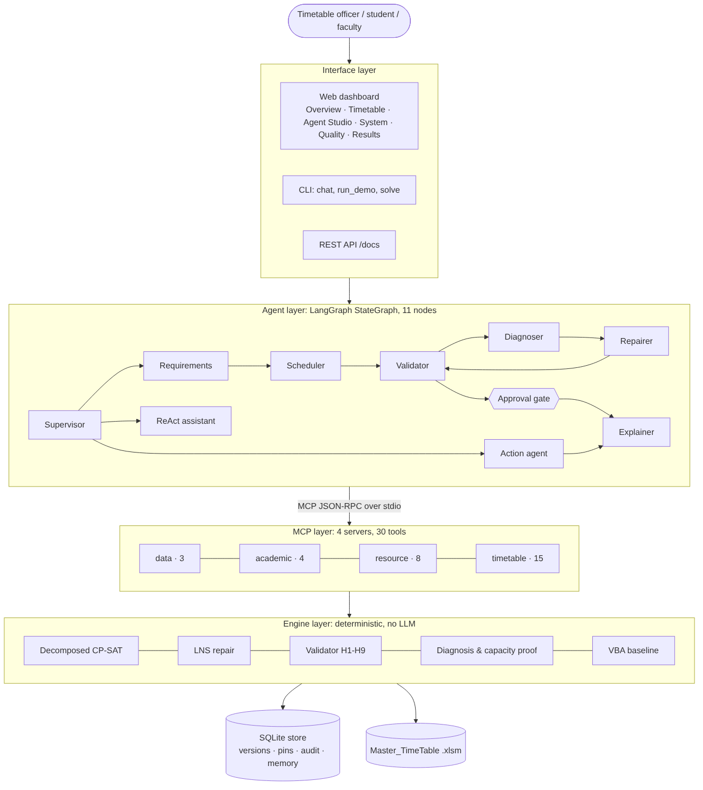

## 5.1 Design principles

1. **Separation of reasoning and computation.** LLMs understand requests and explain results; a
   deterministic solver computes allocations; a separate validator checks them.
2. **A typed tool boundary (MCP).** Agents reach data and the solver only through 30 schema-typed MCP
   tools. Every call is logged.
3. **Explicit, inspectable workflow.** The agent system is a LangGraph *state graph*, not a free-running
   loop, so its control flow can be drawn, tested and audited.
4. **Human in control.** Publishing requires approval (LangGraph `interrupt()`). What-ifs move as little
   as possible. Every version is kept.
5. **Works offline.** With no LLM key, a rule-based supervisor and template explainer keep every
   structured function working; an LLM is an upgrade, not a dependency.

## 5.2 Layers

| Layer | Package | Responsibility | Uses LLM |
|---|---|---|---|
| Interface | `ttagent/api`, `scripts` | Web dashboard, REST API, command-line chat and demo | No |
| Agents | `ttagent/agents` | LangGraph workflow, MCP client bridge, intent parsing, prompts, explanations | Optional |
| MCP | `ttagent/mcp_servers` | 4 servers, 30 tools, 2 resources, 1 prompt, audit log | No |
| Engine | `ttagent/engine` | CP-SAT models, LNS repair, validator, metrics, diagnosis, VBA baseline, service facade | No |
| Domain | `ttagent/domain` | Typed models, time-grid rules, room-suitability policy | No |
| Ingestion | `ttagent/ingestion` | Reads the `.xlsm` exactly as the macro does; inference; data quality | No |
| Store | `ttagent/store` | SQLite shared by all processes: dataset, versions, pins, unavailability, audit | No |

<!-- pagebreak -->

# 6. How the Agents Work

## 6.1 Number and roles of agents

The agent system is a **LangGraph StateGraph with 11 nodes**. Nine of them are *agents*, i.e. nodes
that decide or act. Of the other two, the approval gate is a human-in-the-loop checkpoint and *respond*
is a terminal node. Three nodes can use an LLM; the rest are deterministic and call MCP tools directly,
so the core workflow behaves the same every time.

| # | Node / agent | Role | MCP tools it calls | LLM? |
|---|---|---|---|---|
| 1 | **Supervisor** | Classifies the request into one of 13 intents and extracts parameters (semester, batch, teacher, day, slot…). Routes to the right branch | — | Yes (structured output), with rule-based fallback |
| 2 | **Requirements agent** | Runs the capacity proof before solving and records what-if unavailability | `capacity_report`, `get_requirements`, `add_unavailability` | No |
| 3 | **Scheduler agent** | Requests a new timetable, or a repair of the current one for what-ifs | `generate_timetable`, `repair_timetable` | No |
| 4 | **Validator agent** | Independently re-checks every hard rule and the weekly allocation | `validate_timetable` | No |
| 5 | **Diagnoser agent** | For unplaced sessions: which batch / teacher / room blocks each slot | `explain_unplaced` | No |
| 6 | **Repairer agent** | Runs the LNS repair ladder; loops back to the validator (at most 3 rounds, stops when no progress) | `repair_timetable` | No |
| 7 | **Approval gate** | Pauses the graph (`interrupt`) and asks a human to publish; resumes on the answer | `publish_timetable` | No (human) |
| 8 | **Action agent** | Single-step requests: view, validate, explain, move, compare, quality, capacity, export, publish | `view_timetable`, `validate_timetable`, `explain_unplaced`, `move_session`, `compare_timetables`, `data_quality_report`, `capacity_report`, `export_timetable`, `publish_timetable` | No |
| 9 | **ReAct assistant** | Free-form questions: reasons and calls any of the 30 tools itself [10] | any | Yes |
| 10 | **Explainer** | Turns tool results into a plain-language answer grounded only in those facts; deterministic template when offline | — | Yes, with template fallback |
| 11 | **Respond** | Appends the answer to the conversation memory | — | No |

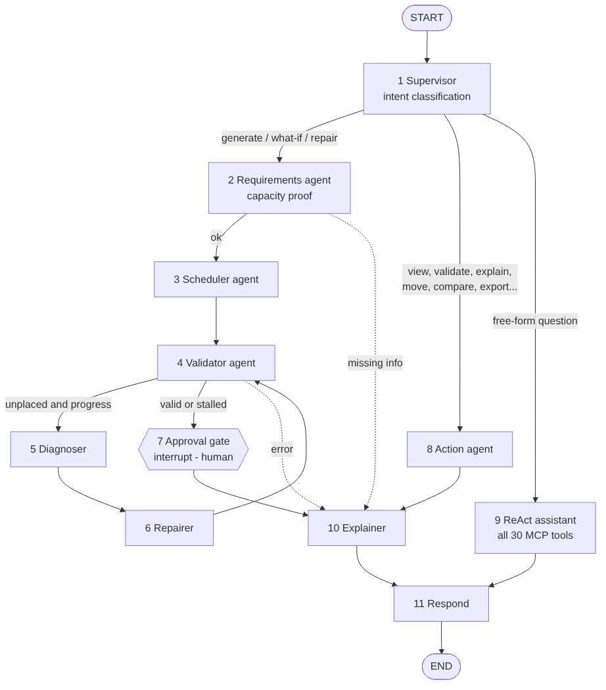

## 6.2 Shared state and memory

All nodes read and write a typed state (`AgentState`):

* `messages`: the conversation;
* `request` and `intent`;
* `result`: the facts gathered from tools;
* `solution_id` and `last_solution_id`;
* `repair_iterations`;
* `trace`: every node visited and MCP call made, with arguments and latency;
* `answer`.

State is **checkpointed to SQLite** after every node (`AsyncSqliteSaver`) under a `thread_id`. A
conversation, and even a pending approval, survives a restart of the application.

## 6.3 Control flow

* **Generate / what-if / repair:** supervisor → requirements → scheduler → validator. If sessions remain
  unplaced *and* the last repair made progress: diagnoser → repairer → validator (loop). Otherwise:
  approval → explainer → respond.
* **Single actions:** supervisor → action → explainer → respond.
* **Free-form questions:** supervisor → ReAct assistant → respond.

## 6.4 Worked example: "Generate timetable for Year 2"

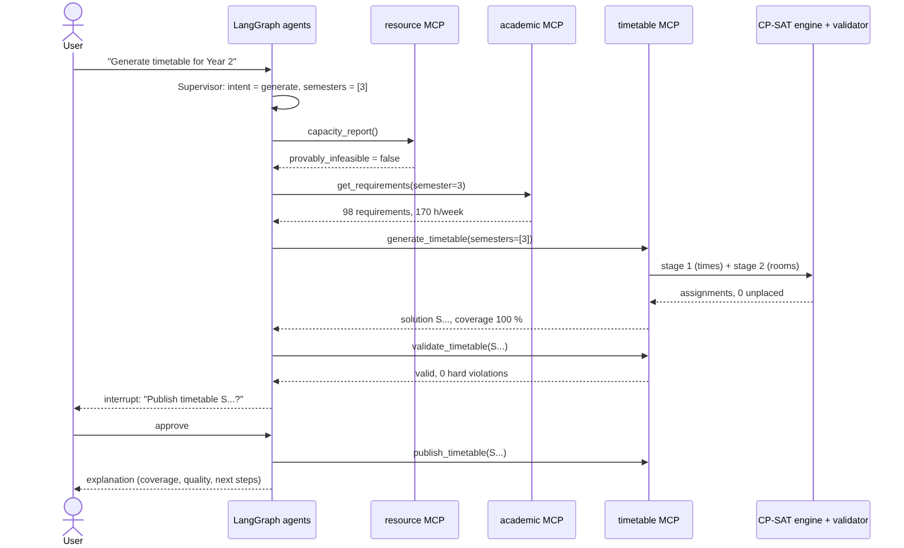

1. **Supervisor:** intent `generate`; year 2 maps to semester 3.
2. **Requirements agent:** `capacity_report` shows not provably infeasible; `get_requirements(3)` returns
   98 requirements, 170 h/week.
3. **Scheduler agent:** `generate_timetable(semesters=[3])`; the engine places 170/170 h.
4. **Validator agent:** `validate_timetable` reports valid, 0 hard violations.
5. **Approval gate:** the graph pauses with "Publish timetable S…? coverage 100 %, hard violations 0".
   The user approves, and `publish_timetable` runs.
6. **Explainer:** summarises coverage, quality metrics and next steps.

## 6.5 LLM providers and offline mode

The LLM layer supports Google Gemini, Anthropic Claude, OpenAI and local Ollama models, selected by an
environment variable. Without a key, the supervisor uses a deterministic intent parser, which routed
**32/32 (100 %)** of a labelled request set correctly (Section 11.6). The explainer then uses Markdown
templates. Only free-form questions need an LLM.

<!-- pagebreak -->

# 7. MCP Servers and Tools

## 7.1 Why MCP

MCP turns the scheduling engine into a **service with a contract**. Each tool has a name, a description
and a JSON input schema. The client bridge converts these schemas into typed LangChain tools, so the LLM
sees real parameter types. Every call crosses a process boundary, and an `audited` decorator records its
arguments, a result summary, its latency and its status in SQLite. The same servers can be used, unchanged,
from **Claude Desktop** or any other MCP client.

## 7.2 The four servers

| Server | Module | Tools | Purpose |
|---|---|---|---|
| **data** | `data_server.py` | 3 | Ingest the workbook; data-quality report; list issues |
| **academic** | `academic_server.py` | 4 | Semesters, batches, requirements, elective baskets (read-only) |
| **resource** | `resource_server.py` | 8 | Rooms, faculty, capacity proof, free slots, what-if unavailability |
| **timetable** | `timetable_server.py` | 15 (+2 resources, 1 prompt) | The only server that can create or change a timetable |

All servers run as separate operating-system processes with **stdio transport** (JSON-RPC over
stdin/stdout), started by the agent's `MCPBridge` with the same Python interpreter. Because each server
is its own process, shared state lives in SQLite, not in memory.

## 7.3 Tool reference

| Server | Tool | What it does |
|---|---|---|
| data | `ingest_workbook` | Parse the `.xlsm`, infer rooms/faculty/electives/external bookings, store the dataset |
| data | `data_quality_report` | The full quality report, or one section of it |
| data | `list_data_issues` | Issues filtered by severity / category |
| academic | `get_overview` | Semesters, batches, courses, hours, baskets, time grid |
| academic | `get_requirements` | Requirements filtered by semester, batch, course, faculty, type |
| academic | `get_batch_profile` | One batch: courses, strict vs elective-aware hours, capacity |
| academic | `get_elective_baskets` | Learned elective baskets with their requirements |
| resource | `list_rooms` | Rooms with category and observed capacity |
| resource | `list_faculty` | Faculty with weekly load; placeholders marked |
| resource | `get_faculty_profile` | What one teacher teaches; unavailability |
| resource | `capacity_report` | Pigeonhole feasibility proof for batches, teachers, room pools |
| resource | `find_free_slots` | Free hours of a batch / teacher / room in a timetable |
| resource | `add_unavailability` | Record a what-if (who, which day/slot); returns affected sessions |
| resource | `list_unavailability` / `remove_unavailability` | Manage what-if constraints |
| timetable | `generate_timetable` | Solve (decomposed / exact / VBA baseline) and store a new version |
| timetable | `validate_timetable` | Independent check of rules H1–H9 and allocation |
| timetable | `get_solution_summary` | Coverage, violations, quality, repair rounds of a version |
| timetable | `view_timetable` | Weekly grid for a batch / teacher / room / semester |
| timetable | `explain_unplaced` | Per-slot blockers, safe havens, room changes that would help |
| timetable | `move_session` | What-if move; committed only if it breaks no hard rule |
| timetable | `repair_timetable` | LNS repair after new constraints or unplaced sessions |
| timetable | `pin_session` / `list_pins` / `remove_pin` | Fix a session for future solves |
| timetable | `compare_timetables` | Metrics of two versions side by side |
| timetable | `publish_timetable` | Mark a *valid* version as published (refuses invalid ones) |
| timetable | `export_timetable` | Excel in the institution's format, iCalendar, JSON |
| timetable | `list_solutions` / `audit_log` | Version history; recent MCP calls |

**Resources:** `timetable://overview`, `timetable://solutions`. **Prompt:** `plan_semester(semester)`.

<!-- pagebreak -->

# 8. The Constraint Engine

## 8.1 Hard constraints (validator rules)

| Rule | Constraint |
|---|---|
| H1 | No batch in two places at once. Exception: sessions of the *same* elective basket may overlap, but a section blocks only its own batches |
| H2 | No real teacher in two places at once (department placeholders exempt) |
| H3 | No room holds two sessions at once |
| H4 | Nothing in the lunch slot (13:00–14:00) |
| H5 | Only teaching slots (1–4, 6–7; slot 8 only if the extended policy was used); Saturday ends 13:00 |
| H6 | Lab blocks are contiguous and never cross lunch |
| H7 | A requirement meets at most once per day |
| H8 | Room is suitable: compatible category, same lab type, enough observed capacity |
| H9 | Respect teacher / batch / room unavailability |
| A | Allocation: every requirement gets its weekly hours |

## 8.2 Soft objective

The solver minimises a weighted penalty (weights in `config/settings.yaml`). Terms and weights:

* idle gaps in a batch's day (8);
* more than 5 h/day for a batch (6);
* a teacher teaching more than 3 consecutive hours (6);
* a teacher teaching more than 4 h/day (3);
* Saturday hours (2);
* late hours (1);
* use of the 16:00 slot (25);
* room changes from the requested venue (4);
* optionally, distance from the published timetable (stability).

## 8.3 Time-then-room decomposition

A single model with variables `x[session, day, slot, room]` has 50 k–136 k Booleans. Within 60 s it
placed only 71.8 % of hours. The engine therefore decomposes the problem:

* **Stage 1 (times):** about 24.6 k Booleans `y[session, day, slot]`. Room feasibility is kept by
  **569 Hall-type cuts** [9]: for every slot, room pool and capacity threshold, the number of sessions
  needing that pool must not exceed the number of free rooms.
* **Lexicographic solve:** phase 1a maximises placed hours; phase 1b minimises the soft penalty while
  keeping that placement.
* **Stage 2 (rooms):** a CP-SAT matching assigns rooms, minimising changes from the requested venue and
  over-sized rooms.

## 8.4 LNS repair ladder and minimal perturbation

When sessions remain unplaced, or a what-if displaces sessions, the repairer frees a *neighbourhood*: the
sessions most likely to block, ranked same batch, then same teacher, then same venue. It freezes
everything else and re-solves:

1. **Level 0:** exact model (rooms inside) on 60 sessions;
2. **Level 1:** decomposed model on 320 sessions;
3. **Level 2:** additionally allow the 16:00 slot (reported to the user);
4. a re-seeded retry of levels 1–2.

Each moved session pays a stay-put penalty, which implements **minimal perturbation** [8]. Two subtle
issues had to be fixed before repairs were truly minimal:

* symmetry-breaking ordering made warm starts infeasible after edits;
* a truncated room list could omit a session's current room.

## 8.5 Independent validator and baseline

The validator (`engine/validator.py`) shares *no code* with the solvers. It re-derives every rule from
plain booking objects, so it can judge any timetable, including the hand-edited one. A faithful Python
port of `Allot` (`engine/greedy_vba.py`) serves as the research baseline. It leaves 37 requirements
unplaced against the macro's 40, with a Jaccard overlap of 0.79 on *which* rows fail.

<!-- pagebreak -->

# 9. Interface and Explainability

## 9.1 Web dashboard

The dashboard (FastAPI + a single-page front-end) has six pages:

| Page | Purpose |
|---|---|
| Overview | Coverage ring, hard violations, quality KPIs, comparison bars against the published grid, hours by day and slot |
| Timetable | Colour-coded weekly grid for any batch / teacher / room / semester; Excel and calendar export |
| Agent Studio | Chat with the agents; the LangGraph diagram lights up each node live; MCP server cards flash on each call; per-turn trace; approval card |
| System & MCP | Live architecture with connection status; start the 4 MCP servers; all 30 tools; MCP audit log |
| Data quality | Workbook issues, learned elective baskets, capacity proof |
| Research results | Experiment figures |

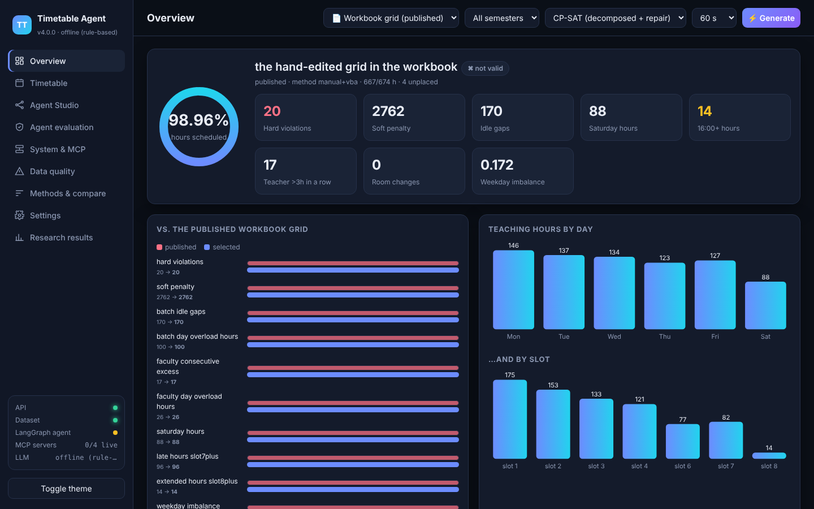

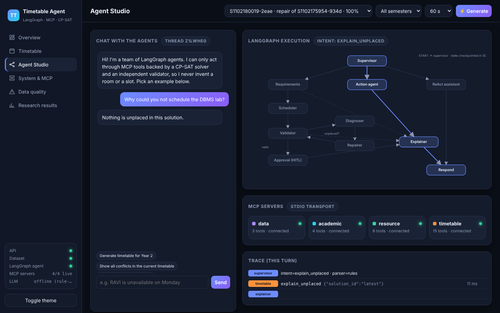

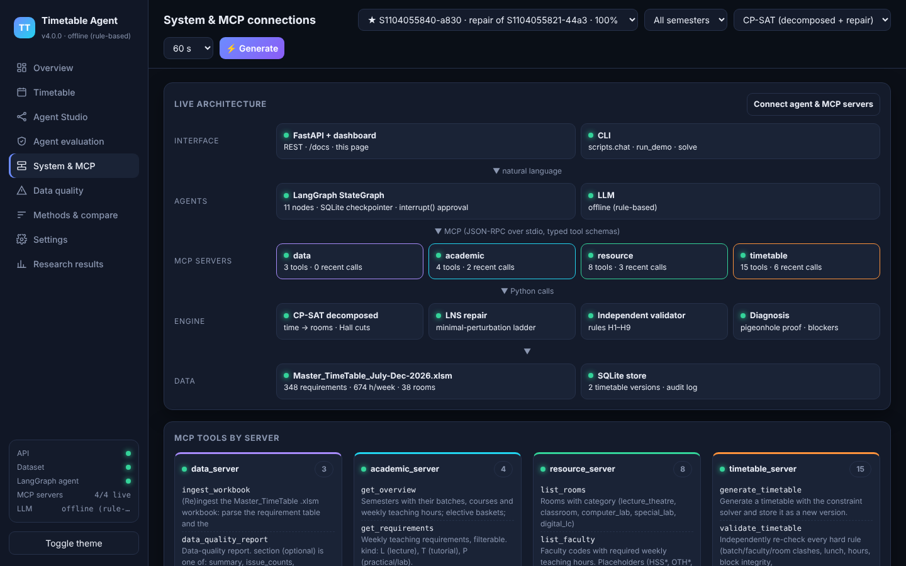

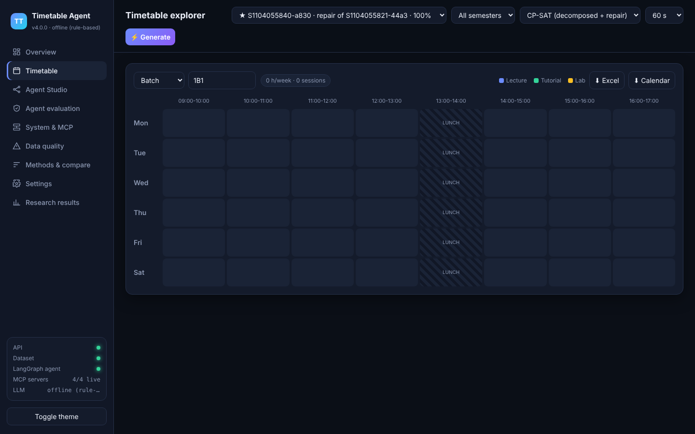

## 9.2 Explainability mechanisms

| Mechanism | Question it answers | Where |
|---|---|---|
| **Capacity proof** | *Can* this be scheduled at all? Which resource makes it impossible? | `capacity_report`, Data-quality page |
| **Blocker analysis** (contrastive) | Why not slot X? Which batch / teacher / room blocks it; where it *would* fit | `explain_unplaced` |
| **Validation report** | Is it correct? Which rule, where | `validate_timetable` |
| **Execution trace** | What did the agents do, in what order, with which arguments? | Agent Studio trace, `trace` in state |
| **MCP audit log** | Every tool call across all servers, with latency and status | `audit_log`, System page |
| **Grounded explanations** | Plain-language summary built only from tool facts; exact figures attached | Explainer agent |
| **What-if transparency** | Which sessions a change affects; how many moved | `add_unavailability`, `move_session` |
| **Version lineage** | Each version records its parent (generate → repair → edit) | SQLite store |
| **Human approval** | A person decides what is published | Approval gate |

<!-- pagebreak -->

# 10. Comparison with Excel Scripting

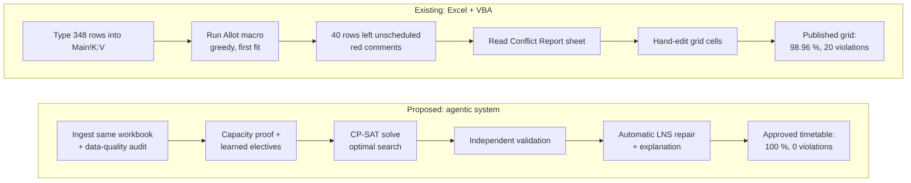

| Dimension | Excel + VBA (existing) | Agentic system (proposed) |
|---|---|---|
| Algorithm | Greedy first-fit, no backtracking | CP-SAT (complete search + optimisation) with decomposition and LNS |
| Weekly hours scheduled | 88.13 % (macro alone); 98.96 % after manual edits | **99.85–100 %** |
| Hard-constraint violations | 4 (macro), **20** (published grid) | **0** |
| Electives | Impossible (any shared batch is a clash) | Learned from data, run in parallel |
| Rooms | Fixed to requested venue | Chosen by the solver, preferring the requested venue |
| Feasibility check | None | Pigeonhole proof before solving |
| Validation | None | Independent validator (H1–H9) on every version |
| Explanation of failure | Conflict sheet: cell coordinates | Per-slot causes, free slots, room alternatives, proof |
| What-if (teacher absent) | Manual edits | One sentence; minimal-change repair (0.5–7 % of sessions moved) |
| Quality optimisation | None | Idle gaps, daily load, teacher fatigue, Saturdays, late hours |
| Interface | Spreadsheet cells and buttons | Natural-language chat, dashboard, REST API, CLI |
| Traceability | None | Execution trace, MCP audit log, version history |
| Human control | Implicit | Explicit approval step before publishing |
| Interoperability | Excel only | MCP tools usable by any MCP client; Excel/ICS/JSON export |
| Data quality | Unchecked | 207 issues found and located |
| Testing | None | 35 automated tests; CI on every push |

The system keeps the institution's own format: its Excel export reproduces the `Main` sheet layout and
token grammar, so the existing `FacultyWise` / `VenueWise` / `SemesterWise` macros still work on its
output.

<!-- pagebreak -->

# 11. Experimental Evaluation

All experiments ran on the real workbook with a 60 s solver budget on a 2-core machine
(`python -m scripts.run_experiments --time 60`). Raw data is in `experiments/results/`.

## 11.1 RQ1: Is the institution's model feasible?

Under the strict model, 23 batches are over capacity (Section 4.4), so it is **provably infeasible**.
With elective baskets, no resource is over capacity (maximum batch utilisation 88.2 %).

## 11.2 RQ2: Method comparison (whole university)

| Method | Coverage | Hard viol. | Idle gaps | Sat h | 16:00+ h | Teacher >3 h run | Weekday imbalance | Time |
|---|---|---|---|---|---|---|---|---|
| Published grid (manual + macro) | 98.96 % | 20 | 170 | 88 | 14 | 17 | 0.172 | – |
| VBA `Allot` (Python port) | 88.13 % | 4 | 238 | 49 | 0 | 19 | 0.569 | 0.03 s |
| CP-SAT exact (rooms inside) | 71.81 % | 0 | 268 | 56 | 0 | 2 | 0.070 | 63 s |
| CP-SAT decomposed (no repair) | 98.96 % | 0 | 114 | 69 | 0 | 11 | 0.042 | 56 s |
| **Decomposed + LNS repair (ours)** | **99.85 %** | **0** | **110** | 70 | **0** | 14 | **0.041** | 97 s |
| Ours + stability (keep published) | 99.70 % | 0 | 143 | 81 | 0 | 15 | 0.102 | 98 s |

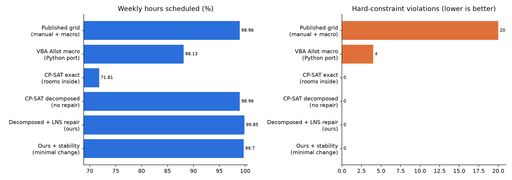

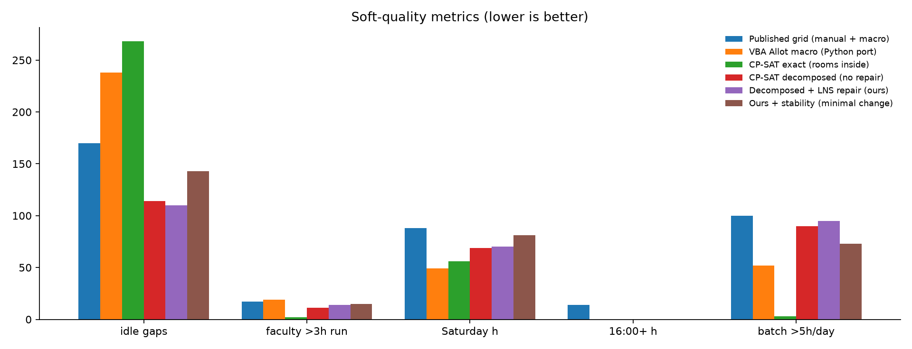

Compared with the published grid, the proposed system has:

* no clashes;
* no classes at 16:00 or on Saturday afternoon;
* **35 % fewer idle gaps**;
* **20 % fewer Saturday hours**;
* a **4× more even spread across weekdays**.

With a 90 s budget (seed 11), the full university reached **674/674 h (100 %)**, valid; this run is
included as `samples/timetable_full_university_100pct.xlsx`.

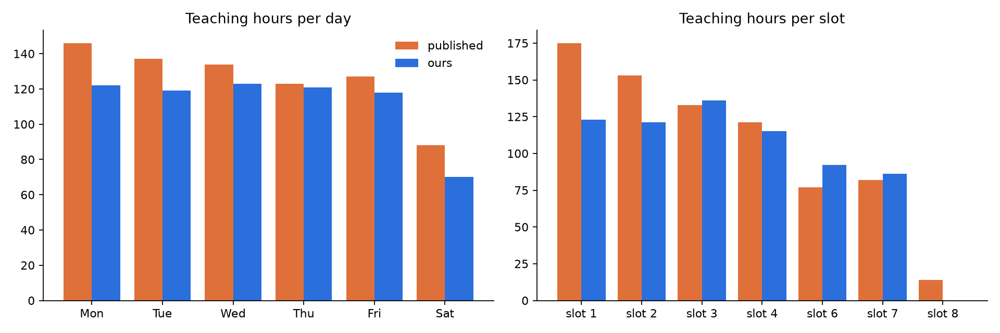

## 11.3 RQ3: Ablation

| Variant (stage 1 only, same budget) | Coverage | Soft penalty |
|---|---|---|
| Full model | 99.41 % | 1,929 |
| No elective baskets | 93.03 % | 1,978 |
| Requested venue only (no room choice) | 84.72 % | 1,850 |
| No soft objective | 99.85 % | 2,698 (+40 %) |

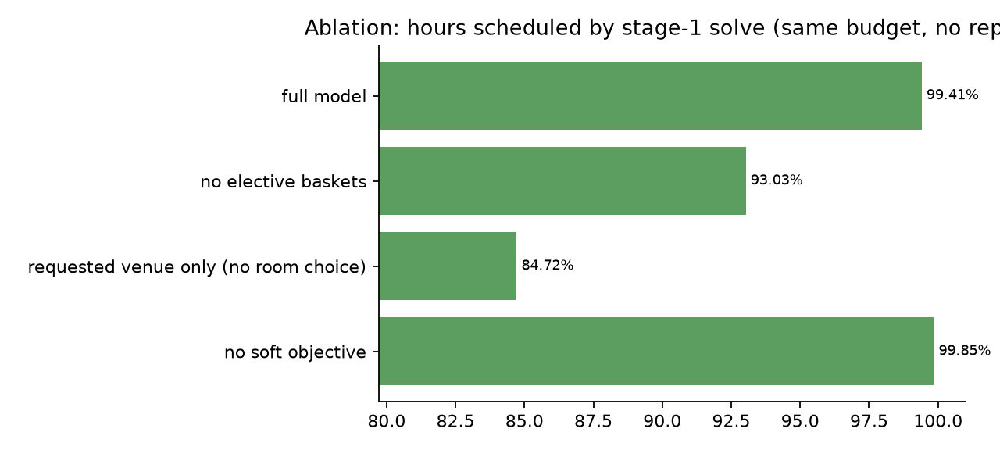

## 11.4 RQ4: Robustness

Seeds 7, 11 and 23 gave **99.85 %, 100 % and 100 %** coverage (mean 99.95 %). Every run had zero hard
violations. The soft penalty was 2,489 ± 167.

## 11.5 RQ5: What-if resilience

| Teacher / day | Displaced | Hard viol. after | Constraint respected | Sessions touched | Time |
|---|---|---|---|---|---|
| RAVI / Fri | 2 | 0 | yes | 33 (5.8 %) | 40 s |
| AKD / Wed | 3 | 0 | yes | 40 (7.1 %) | 11 s |
| DRM / Mon | 1 | 0 | yes | 3 (0.5 %) | 27 s |
| DKR / Mon | 3 | 0 | yes | 41 (7.2 %) | 2 s |
| SG / Fri | 2 | 0 | yes | 31 (5.5 %) | 1 s |
| RP / Wed | 3 | 0 | yes | 33 (5.8 %) | 10 s |

Before the stay-put penalty was added, the same repairs moved 35–52 % of all sessions.

## 11.6 RQ6: Agent routing

On 32 labelled requests covering all 13 intents, including every example in the original project brief,
the offline supervisor routed **32/32 (100 %)** correctly. End-to-end tests verify the generate
trajectory: `capacity_report → get_requirements → generate_timetable → validate_timetable → approval`.

<!-- pagebreak -->

# 12. Version 3: GA Comparison, Public Benchmark and Strengthening

The project review asked for three additions: a genetic-algorithm (GA) allocator to compare against, a
qualitative and quantitative comparison with the existing approach, and work on the limitations of version 2
(now listed, with their status, in Section 15). This chapter reports all three, together with a public benchmark and
the packaging of the system as installable software. Full details are in `docs/V3_ANALYSIS.md`.

## 12.1 The GA allocator

Plain GAs are known to be weak on highly constrained timetabling. Lewis and Paechter found that their
grouping GA worked best with its crossover removed [21], and Rossi-Doria et al. found that no metaheuristic
was best on every instance [22]. The GA was therefore built as a *strong* memetic baseline rather than a
straw man, and it shares the data, rules and soft weights of the CP-SAT engine.

| Component | Design |
|---|---|
| Encoding | One gene (day, start slot, room) per weekly session, drawn only from legal candidates: lunch, lab-block contiguity, Saturday cut-off, fixed bookings and unavailability are already filtered |
| Seeding | Randomised most-constrained-first greedy construction, capped at 30 % of the budget |
| Crossover | Requirement-level uniform crossover: all sessions of one requirement come from the same parent |
| Mutation | Re-sample a session's gene (rate 0.03 per requirement) |
| Local search | Conflict-directed best-improvement moves; once feasible, soft-improving moves (the "memetic" part) |
| Selection | Tournament (k = 3), steady-state replacement of the worst, elitism, duplicate rejection |
| Fitness | 10 000 × hard conflicts + soft penalty, with the same weights as CP-SAT |
| Evaluation | Incremental occupancy counters; a test checks that it always equals full re-scoring |
| Output | Sessions still in conflict are un-placed, so the result is clash-free |

A *plain GA* without local search serves as an ablation. The GA is available everywhere the other methods are:
`ttagent solve --method ga`, the dashboard's method selector, and the `generate_timetable` MCP tool.

## 12.2 Quantitative comparison on the real workbook

Each method ran 5 times (seeds 1–5) for 120 s on the whole university. Table values are mean ± standard
deviation. Soft penalty per scheduled hour is reported because unscheduled sessions carry no soft penalty.

| Method | Coverage | Hard viol. | Soft penalty | Soft / scheduled h | Idle gaps | Room changes | Teacher >3 h run |
|---|---|---|---|---|---|---|---|
| Published grid | 98.96 % | 20 | 2,762 | 4.14 | 170 | 0 | 17 |
| VBA macro (port) | 88.13 % | 4 | 2,586 | 4.35 | 238 | 0 | 19 |
| GA, plain (3 runs) | 94.17 ± 1.09 % | 0 | 2,553 ± 220 | 4.02 | 112 | 209 | 20 |
| GA, memetic | 98.10 ± 0.57 % | 0 | 2,870 ± 42 | 4.34 | 124 | 242 | 20 |
| **CP-SAT pipeline (ours)** | **99.76 ± 0.31 %** | **0** | **2,271 ± 269** | **3.38** | **116** | 143 | **9** |

Two-sided Mann–Whitney U tests [28] with Cliff's δ [29] as the effect size:

| Comparison | U | p | Cliff's δ |
|---|---|---|---|
| Coverage, CP-SAT vs memetic GA | 25 | 0.011 | +1.0 |
| Soft penalty, CP-SAT vs memetic GA | 0 | 0.008 | −1.0 |
| Coverage, memetic vs plain GA | 15 | 0.036 | +1.0 |

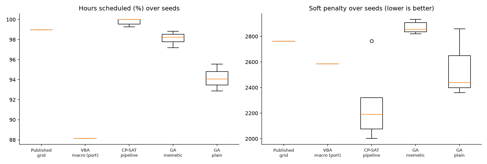

Every CP-SAT run beat every GA run on both coverage and soft quality (|δ| = 1). The memetic GA is
nevertheless a credible baseline: it is clash-free, beats the VBA macro by 10 points of coverage, and its local
search adds 3.9 points over the plain GA. Its weaknesses are structural. It never removed all conflicts within
120 s, so 6–12 sessions are dropped at the end (Figure 14). Its single-session moves also lead to many room
changes and long teaching runs, because it has no global view of a teacher's day.

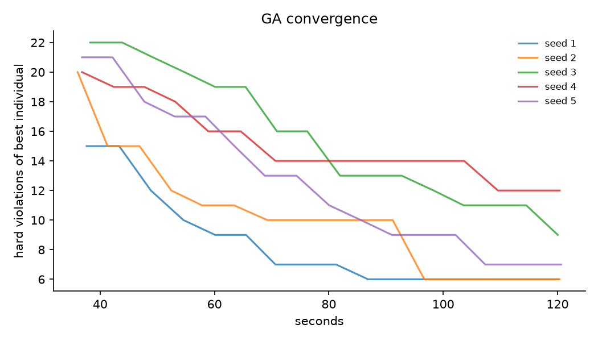

**Per semester** (seed 1), the VBA macro collapses on semester 7 (53.3 %), the case the capacity proof shows to
be infeasible without elective baskets. CP-SAT and the GA both schedule semester 7 completely. The GA's weakest
semester is 5 (94.9 %), the one with the most lab blocks.

**Fairness and anytime behaviour.** The GA is single-threaded. With CP-SAT also restricted to one worker, the
time phase found **no feasible solution** within its share of the 120 s budget, so the pipeline returned
nothing. The pipeline relies on CP-SAT's parallel portfolio, whose feasibility-jump and LNS workers find first
solutions. This is a real limitation; a GA always returns something. With the normal 8-worker portfolio on the
same 2 cores, CP-SAT stays ahead at every budget: at about 77 s of wall time it reaches 99.85–100 %, while the
GA reaches 98.66 % at 61 s and 99.41 % at 240 s (Figure 15). The CP-SAT pipeline needs at least about 77 s,
because the room phase and the repair ladder come on top of the time budget.

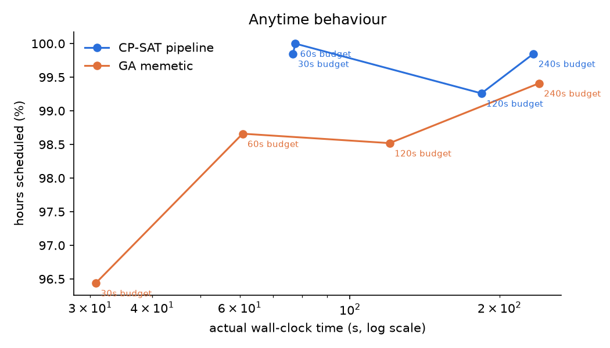

## 12.3 Disruption versus quality in what-if repair

Lindahl et al. [26] warn that minimal-perturbation repair can damage timetable quality. Four disruptions (a
teacher absent for a whole day) were repaired from the best CP-SAT timetable with the stay-put weight *w*
from 0 to 160. Every repair placed all displaced sessions with zero hard violations, in 7–8 s on average.

| Stay-put weight *w* | Sessions moved | % of timetable | Soft penalty change |
|---|---|---|---|
| 0 | 48.8 | 8.6 % | +138.5 |
| 10 | 38.3 | 6.8 % | +121.3 |
| 40 (default) | 34.0 | 6.0 % | +114.8 |
| 160 | 32.3 | 5.7 % | +97.5 |

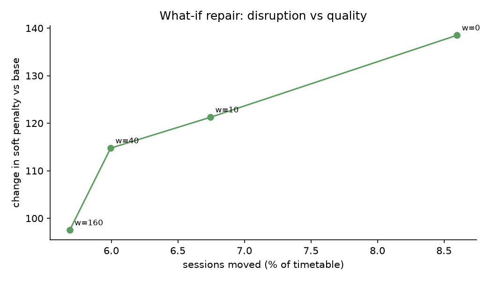

Here the trade-off does not appear: **a higher stay-put weight gives both fewer changes and a smaller loss of
quality.** Repair optimises feasibility and stability only, so a session moved without need lands in an
arbitrary legal slot, usually a worse one. When the starting timetable is already optimised, staying close to
it is the best way to keep its quality.

## 12.4 Public benchmark: ITC-2007 Track 3

To test whether the results hold beyond one institution, the engine and the GA were adapted to the
curriculum-based course timetabling (CB-CTT) track of ITC-2007 under the standard UD2 formulation [20][23].
All 21 instances were taken from the competition winner's repository. Every solution was re-scored by an
independent UD2 scorer. Each method had 120 s per instance on 2 cores (seed 7). Best-known values and the
time-limited results of Abdullah & Turabieh [24] and Kiefer et al. [25] come from the survey of Ceschia et al. [23].

| Inst. | Best known | GA | CP-SAT | CP-SAT bound | Kiefer [25] avg |
|---|---|---|---|---|---|
| comp01 | 5 | 27 | **5** (optimal) | 5 | 5.0 |
| comp02 | 24 | 272 | **101** | 10 | 41.5 |
| comp03 | 64 | 272 | **129** | 24 | 71.7 |
| comp04 | 35 | 160 | **35** (optimal) | 35 | 35.1 |
| comp05 | 284 | 1034 | **464** | 80 | 305.2 |
| comp06 | 27 | 352 | **184** | 8 | 47.8 |
| comp07 | 6 | 412 | **253** | 0 | 14.5 |
| comp08 | 37 | 194 | **92** | 36 | 41.0 |
| comp09 | 96 | 254 | **142** | 30 | 102.8 |
| comp10 | 4 | 270 | **190** | 4 | 14.3 |
| comp11 | 0 | 10 | **0** (optimal) | 0 | – |
| comp12 | 294 | 849 | **431** | 82 | 319.4 |
| comp13 | 59 | 229 | **111** | 58 | 60.7 |
| comp14 | 51 | 218 | **105** | 50 | 54.1 |
| comp15 | 64 | 237 | **153** | 26 | – |
| comp16 | 18 | 281 | **148** | 12 | 33.8 |
| comp17 | 56 | 309 | **191** | 26 | 75.7 |
| comp18 | 61 | 169 | **105** | 22 | 66.9 |
| comp19 | 57 | 250 | **116** | 42 | 62.6 |
| comp20 | 4 | 493 | **293** | 0 | 27.2 |
| comp21 | 74 | 313 | **249** | 14 | 97.0 |

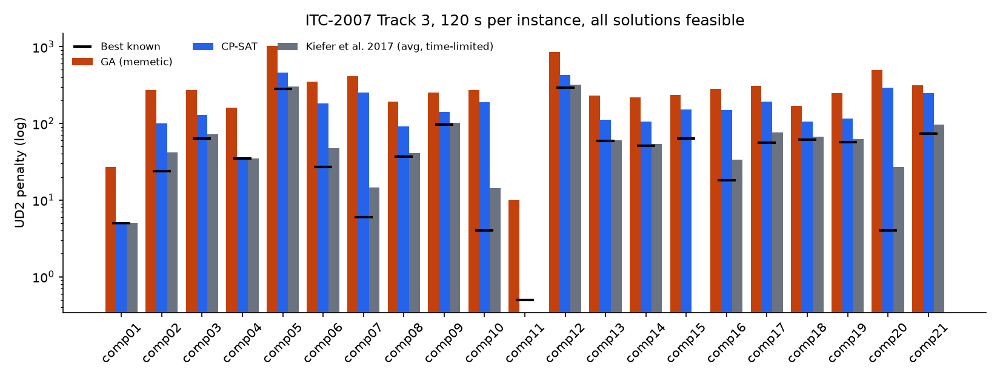

CP-SAT beats the GA on **all 21 instances**, the same ranking as on the institution's data. It proves
optimality on comp01, comp04 and comp11, and on comp08, comp13 and comp14 its lower bound is within 1 of the best
known. On the other instances, both methods are far from the state of the art at this budget: the median gap to
the best known value is 106 % for CP-SAT and 357 % for the GA, and the dedicated metaheuristics of [24] and [25]
are much better. A pilot outer LNS around CP-SAT (free a day, a group of curricula or some rooms; re-solve the
rest fixed) reached 102 on comp02 against 101 for plain CP-SAT, so it gave no gain at this budget. **The project
therefore does not claim state-of-the-art results on ITC-2007.** The benchmark shows that the model is correct
and general, and that the CP-SAT > GA ranking is not an artefact of one data set.

## 12.5 Qualitative comparison with the existing approach

| Property | Excel + VBA macro | Memetic GA | This system |
|---|---|---|---|
| Hard constraints guaranteed | No: 4 violations (port), 20 in the published grid | Only by dropping conflicting sessions | Yes, and re-checked by an independent validator |
| Detects an impossible problem | No: rows silently left empty | No: a high penalty looks the same | Yes: capacity proof plus per-slot blocker report |
| Quality bound | None | None | Lower bound reported by the solver |
| Explains a missing class | No | No | Yes: blockers of every candidate slot, and room changes that would fix it |
| Teacher becomes unavailable | Re-run, then fix by hand | Re-run; the result can change completely | Minimal-change repair, 6 % of sessions moved |
| Reproducibility and audit | Deterministic, no log | Depends on the seed, no log | Versions with parents; every MCP call logged |
| Human control | Manual editing | Parameters only | Natural language, approval before publishing, pins, settings page |
| Works without an LLM | Yes | Yes | Yes (rule-based supervisor) |

**Explainability example (real output).** The `explain_unplaced` tool was run on the *published* timetable.
One of the two weekly CMD lectures of batches 3B7–3B9 (teacher NEEJ, room LT2) is missing. The tool checked
all 34 possible start slots: the batch was busy in 32, room LT2 in 30 and the teacher in 11. No slot had LT2
free, but **Monday 11:00–12:00 works in LT4 or LT9**, where LT2 (taken by the 3B4–3B6 DS lecture) was the
only obstacle. A timetabling officer can act on this directly; neither the macro nor the GA can produce it.

**Case study.** The weekly heatmaps for one batch per year (Figure 18) show the character of each method.
For first-year batch 1B1, the GA packs all teaching into mornings (four classes in a row every morning)
because its local search removes idle gaps first. CP-SAT and the published grid use full days with lunch free.
The dark cells in years 3 and 4 are parallel electives taught to different sub-groups in the same slot, which
all three timetables use by design.

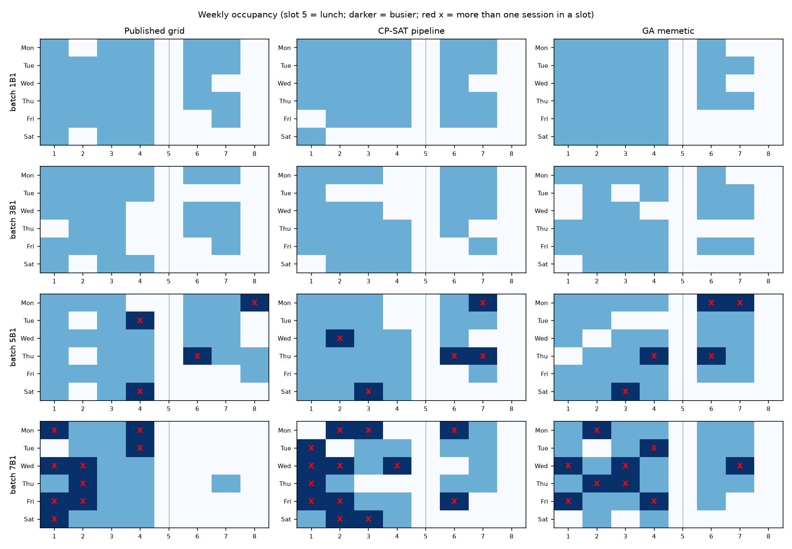

## 12.6 Limitations addressed

| Limitation (v2) | What v3 does |
|---|---|
| Room capacity was a proxy | Optional `config/rooms.yaml` (seats) and `config/batches.yaml` (students). When both are known, a room is suitable only if seats ≥ students |
| Elective baskets inferred from one term | Each basket has a confidence (high, medium, low) from its supporting evidence; non-high baskets are flagged for confirmation |
| No teacher preferences | Soft "avoid" preferences per teacher (day or day and slot), penalised by CP-SAT and the GA and reported as a metric |
| Quality depends on time and cores | Anytime study and a single-worker run (Section 12.2) |
| No public benchmark | ITC-2007 Track 3, all 21 instances (Section 12.4) |
| Minimal change may hurt quality | Disruption-versus-quality study (Section 12.3) |
| LLM evaluation on a small set | A held-out set of 77 phrasings over 13 intents (offline router: 92.2 % action accuracy, 88.3 % exact match), an automatic check of the numbers in LLM explanations, and an LLM-only scheduling baseline (`ttagent llm-eval`, run with the user's own API key) |

The offline router's accuracy fell from 100 % on the 32 requests it was developed with (Section 11.6) to 92.2 %
on new phrasings. Typical misses are *"any double booking of teachers?"* (sent to chat instead of a conflict
check) and *"show me JP's weekly schedule"* (sent to generate). The router was deliberately not tuned on this set,
so the figure stays an honest held-out estimate; with an LLM key, such requests fall through to the ReAct assistant.

## 12.7 Packaging as software

* An installable Python package (`pyproject.toml`, version 3.0.0) with one `ttagent` command and the
  subcommands `serve`, `ingest`, `solve`, `validate`, `chat`, `demo`, `benchmark`, `experiments`, `llm-eval` and `mcp-tools`.
* A double-click Windows launcher, `TimetableAgent.bat`, which installs on first run, loads the workbook and
  opens the browser (`run.sh` on macOS and Linux).
* Dashboard additions: a method selector; a *Methods & compare* page that runs methods head-to-head on the
  same scope and budget; a *Settings* page saved to `config/overrides.yaml`; workbook upload; the version and LLM status.
* Ten new automated tests (45 in total), including incremental-evaluation checks for both GAs and the ITC scorer.

<!-- pagebreak -->

# 13. Contributions and Novelty

## 13.1 Contributions

1. **A diagnosis of a real institutional timetabling process.** It includes a pigeonhole proof that the
   existing macro's constraint model is infeasible (23 batches over capacity) and a validation of the
   published grid (20 hard violations).
2. **Constraint learning from human practice.** Elective baskets are inferred automatically from how
   staff co-scheduled courses in the published grid. Together with treating venues as preferences, this
   turns an infeasible model into a solvable one (ablation: +6.4 and +14.7 coverage points).
3. **A tractable solver for the real instance.** A time-then-room CP-SAT decomposition with Hall-type
   room cuts and lexicographic phases reaches 99.0 % without repair, where the monolithic model
   reaches 71.8 %.
4. **Minimal-perturbation LNS repair for live what-ifs.** It moves 0.5–7.2 % of sessions per
   disruption, down from 35–52 %, and identifies two warm-start pitfalls.
5. **A safe agentic architecture.** A LangGraph multi-agent workflow (11 nodes) acts only through 30
   audited MCP tools. It has an independent validator, a repair loop, a human approval interrupt,
   persistent memory, and an offline mode that needs no LLM.
6. **Explainability by construction.** Capacity proofs, contrastive blocker analysis, grounded
   explanations, a live execution trace and an audit log, surfaced in a dashboard.
7. **A reproducible research artefact.** A faithful port of the institution's macro as a baseline, an
   experiment suite (RQ1–RQ6), 45 tests and CI.
8. **A fair GA-versus-CP-SAT comparison on identical real and benchmark instances** (version 3). A strong
   memetic GA shares the data, rules and weights; CP-SAT wins every run on the real workbook (Cliff's δ = 1)
   and every ITC-2007 instance. The literature review found no earlier head-to-head study of this kind.
9. **An empirical answer to the minimal-perturbation critique.** On an optimised timetable, a stronger
   stay-put weight reduced both disruption and quality loss, so staying close was not costly here.

## 13.2 Novelty and positioning

The individual techniques are established: CP-SAT [6][30], time-then-room decomposition with Hall-type cuts [27], LNS [7], minimal perturbation [8], ReAct [10],
LangGraph [16], MCP [15]. Prior LLM-plus-optimisation work focuses on *formulating* models from text
[12][13] or *explaining* schedules [14]. The novelty of this project lies in:

* **the integration:** an MCP-bounded, LangGraph-orchestrated multi-agent workflow in which the LLM is
  structurally prevented from scheduling, combined with an independent validator and human approval;
* **the use of real institutional data**, which yields a provable diagnosis of the existing process
  rather than benchmark scores alone;
* **data-driven recovery of hidden constraints** (elective baskets) from a human-made artefact;
* **minimal-change repair exposed as a conversational what-if**.

The claim is therefore *a novel integration, validated on real data with measured improvements over the
existing process and over a strong GA*. It is not a claim of state-of-the-art performance on public timetabling benchmarks;
Section 12.4 now reports it, and Section 15 lists what remains.

<!-- pagebreak -->

# 14. Implementation and Project Structure

## 14.1 Technology stack

| Component | Technology (version) |
|---|---|
| Language | Python 3.14 (3.10+ supported) |
| Agents | LangGraph 1.2.11, LangChain 1.3.16, langgraph-checkpoint-sqlite 3.1.3 |
| Protocol | MCP Python SDK 1.29.0 (FastMCP, stdio) |
| Solver | Google OR-Tools CP-SAT 9.15 |
| LLM providers | Gemini (langchain-google-genai 4.3.5), Claude (langchain-anthropic 1.6.1), OpenAI, Ollama |
| Data | openpyxl 3.1.5, pandas, networkx 3.7, Pydantic 2.13 |
| API / UI | FastAPI 0.141, Uvicorn 0.52, vanilla JavaScript + SVG |
| Storage | SQLite (WAL) |
| Statistics | SciPy (Mann–Whitney U), Matplotlib |
| Packaging | pyproject.toml, `ttagent` command, Windows launcher |
| Quality | pytest (45 tests), GitHub Actions CI |

## 14.2 File structure

```
university-timetable-agent/
├── README.md                     project overview, quick start, results, screenshots
├── LICENSE                       MIT
├── requirements.txt              pinned dependencies
├── .env.example                  optional LLM keys
├── .github/workflows/ci.yml      runs the tests on every push
├── config/
│   ├── settings.yaml             slots, lunch, weights, approval, LLM
│   └── *.example.yaml            templates for seat counts and batch sizes (v3)
├── data/
│   ├── raw/                      Master_TimeTable_July-Dec-2026.xlsm (input)
│   ├── benchmarks/itc2007/       comp01–comp21.ctt (v3)
│   ├── processed/                dataset, quality report, electives (generated)
│   └── state/                    timetable.db, agent_memory.db (generated)
├── ttagent/                      the application package
│   ├── config.py                 settings loader and paths
│   ├── ingestion/
│   │   ├── token_parser.py       token grammar, normalisation, recovery
│   │   ├── excel_loader.py       workbook → dataset, electives, external bookings
│   │   └── quality.py            data-quality report
│   ├── domain/
│   │   ├── models.py             Requirement, Room, Faculty, Booking, Dataset
│   │   ├── timegrid.py           days, slots, lunch, lab-block starts
│   │   └── rooms.py              room-suitability policy
│   ├── engine/
│   │   ├── decomposed.py         time-then-room CP-SAT (default solver)
│   │   ├── cpsat.py              exact CP-SAT model (rooms inside)
│   │   ├── repair.py             LNS repair ladder, minimal perturbation
│   │   ├── greedy_vba.py         Python port of the VBA Allot macro
│   │   ├── ga.py                 memetic genetic algorithm (v3)
│   │   ├── validator.py          independent rules H1–H9 + allocation
│   │   ├── metrics.py            soft-quality metrics
│   │   ├── diagnosis.py          capacity proof, blocker analysis
│   │   └── service.py            facade used by MCP servers, API, scripts
│   ├── benchmarks/               ITC-2007: ctt (parser, UD2 scorer), ctt_cpsat, ctt_ga, ctt_lns (v3)
│   ├── cli.py                    the `ttagent` command (v3)
│   ├── store/db.py               SQLite persistence
│   ├── export/
│   │   ├── excel.py              institution-format workbook
│   │   └── ics.py                iCalendar
│   ├── mcp_servers/
│   │   ├── common.py             audit decorator, logging
│   │   ├── data_server.py        3 tools
│   │   ├── academic_server.py    4 tools
│   │   ├── resource_server.py    8 tools
│   │   └── timetable_server.py   15 tools + 2 resources + 1 prompt
│   ├── agents/
│   │   ├── graph.py              LangGraph StateGraph (11 nodes)
│   │   ├── agent.py              session: MCP bridge + graph + checkpointer
│   │   ├── mcp_bridge.py         spawns MCP servers; MCP → LangChain tools
│   │   ├── intent.py             intent schema + rule-based parser
│   │   ├── llm.py                LLM providers (Gemini/Claude/OpenAI/Ollama/offline)
│   │   ├── prompts.py            system prompts
│   │   └── render.py             template explanations (offline / fallback)
│   └── api/
│       ├── main.py               FastAPI endpoints
│       └── static/index.html     dashboard
├── scripts/                      ingest, solve, chat, run_demo, run_experiments,
│                                 run_analysis_v3, run_benchmark_itc, report_itc, run_llm_eval
├── tests/                        45 tests on the real workbook and ITC-2007
├── experiments/llm_eval/         77 labelled requests (v3)
├── experiments/results/          CSV, JSON and figures for RQ1–RQ6; v3/ and itc2007_* (v3)
├── pyproject.toml                package definition and `ttagent` entry point (v3)
├── TimetableAgent.bat, run.sh    one-click launchers (v3)
├── samples/                      solved full-university timetable (.xlsx)
└── docs/                         reports, user guide, demo, media/
```

## 14.3 Code size

| Package | Lines of Python | Files |
|---|---|---|
| ingestion | 436 | token_parser, excel_loader, quality |
| domain | 280 | models, timegrid, rooms |
| engine | 1,991 | decomposed, cpsat, repair, greedy_vba, validator, metrics, diagnosis, service |
| store + export | 352 | db, excel, ics |
| mcp_servers | 391 | common + 4 servers |
| agents | 963 | graph, agent, mcp_bridge, intent, llm, prompts, render |
| api | 298 (+356 HTML/JS) | main, index.html |
| scripts | 445 | ingest, solve, chat, run_demo, run_experiments |
| tests | 293 | 4 test modules + fixtures |

## 14.4 How to run

```
python -m venv .venv
.venv\Scripts\Activate.ps1                  (Windows; Linux: source .venv/bin/activate)
python -m pip install -e .                  installs the ttagent command (or double-click TimetableAgent.bat)
ttagent ingest                              parse the workbook
ttagent serve                               dashboard at http://127.0.0.1:8000
python -m scripts.chat --trace              terminal chat with the agents
python -m scripts.run_demo                  scripted demonstration
python -m scripts.solve --time 120          solve and export to Excel
ttagent solve --method ga --time 120       the GA allocator
python -m pytest tests -q                   45 tests
python -m scripts.run_experiments           reproduce RQ1–RQ6
python -m scripts.run_analysis_v3           reproduce Section 12.2–12.3
ttagent benchmark                           reproduce Section 12.4 (ITC-2007)
```

## 14.5 Testing and verification

Tests cover:

* token parsing and normalisation;
* ingestion counts on the real workbook;
* every validator rule, including elective and placeholder exemptions;
* the VBA port's fidelity;
* decomposed and exact solves;
* pins and unavailability;
* an **induced-conflict repair test** (break a valid timetable, forbid the old slots, check the repair);
* the service layer and exports;
* a real **MCP stdio round-trip** across all four servers;
* the **LangGraph agent end-to-end** with approval and persistent memory;
* (v3) the GA's incremental evaluation against full re-scoring, its clash-free output, the ITC-2007 parser,
  scorer, GA and LNS, seat-count suitability, teacher preferences, basket confidence, and the CLI and
  settings overrides.

GitHub Actions runs the suite on every push.

<!-- pagebreak -->

# 15. Limitations and Future Work

Status of the version-2 limitations after version 3:

| Limitation | Status |
|---|---|
| Room capacity was a proxy | **Addressed:** real seats and class sizes can be supplied; the department still has to fill in the numbers |
| Elective baskets inferred from one term | **Mitigated:** confidence levels and flags for confirmation; inferring from several terms needs more workbooks |
| No teacher preferences | **Addressed:** soft time preferences |
| Quality depends on time and cores | **Measured:** anytime study; with one worker the CP-SAT pipeline finds no solution in 120 s, which remains a limitation |
| No public benchmark | **Addressed:** ITC-2007 Track 3; results are far from the state of the art at 120 s |
| LLM evaluation | **Partly addressed:** held-out request set and evaluation harness; the LLM-based part must be run with the user's own API key |

Remaining work:

* **Solver strength on benchmarks:** longer runs, more seeds (at least 10) and Wilcoxon tests across instances;
  a stronger warm start for the single-worker case; and an ITC-2019 evaluation [5] with comparison to UniTime [19].
* **GA tuning:** tune the GA with an automatic configurator (for example irace) and report the tuning budget.
* **Evaluation with people:** a user study with the timetable office, and disruptions sampled from the
  institution's own history of changes.
* **Further constraints:** travel time between buildings and student-level elective enrolment.
* **Paper:** a research paper based on Chapters 4, 11 and 12, after the department has reviewed the results.

# 16. Conclusion

This project shows that an agentic AI system can replace a fragile spreadsheet-macro process **without
handing the combinatorics to a language model**. The LLM agents decide which question to ask the engine
and how to explain the answer. A constraint solver produces every allocation, an independent validator
checks it, and a human approves it. On the institution's real data, the largest gains came from
modelling recovered from the data itself (parallel electives and flexible rooms), which turn a provably
infeasible problem into one solved at 99.85–100 % with zero violations. The decomposition made the
problem tractable, and minimal-perturbation repair made live changes safe. Typed MCP boundaries, a
LangGraph workflow, audit logs and a transparent dashboard make the system explainable and controllable
enough to operate during a live semester.

Version 3 tested these claims against a strong genetic algorithm and a public benchmark. The CP-SAT engine won
every comparison on the institution's data and on all 21 ITC-2007 instances, while the benchmark also showed
honestly how far a general-purpose model at a short budget remains from dedicated state-of-the-art methods.
The GA's main advantage, that it always returns a timetable, matters only when the solver has a single core.
With real seat counts, teacher preferences, confidence-rated elective baskets and a one-click installer, the
system is ready for a pilot with the timetable office.

<!-- pagebreak -->

# References

[1] A. Schaerf, "A survey of automated timetabling," *Artificial Intelligence Review*, vol. 13, no. 2, pp. 87–127, 1999.

[2] E. K. Burke and S. Petrovic, "Recent research directions in automated timetabling," *European Journal of Operational Research*, vol. 140, no. 2, pp. 266–280, 2002.

[3] R. Lewis, "A survey of metaheuristic-based techniques for university timetabling problems," *OR Spectrum*, vol. 30, no. 1, pp. 167–190, 2008.

[4] B. McCollum et al., "Setting the research agenda in automated timetabling: The second international timetabling competition," *INFORMS Journal on Computing*, vol. 22, no. 1, pp. 120–130, 2010.

[5] T. Müller, H. Rudová, and Z. Müllerová, "University course timetabling and International Timetabling Competition 2019," in *Proc. 12th Int. Conf. on the Practice and Theory of Automated Timetabling (PATAT 2018)*, 2018, pp. 5–31.

[6] L. Perron and V. Furnon, "OR-Tools (CP-SAT solver)," Google, 2024. [Online]. Available: https://developers.google.com/optimization

[7] P. Shaw, "Using constraint programming and local search methods to solve vehicle routing problems," in *Principles and Practice of Constraint Programming (CP 1998)*, LNCS 1520, Springer, 1998, pp. 417–431.

[8] R. Barták, T. Müller, and H. Rudová, "A new approach to modeling and solving minimal perturbation problems," in *Recent Advances in Constraints (CSCLP 2003)*, LNCS 3010, Springer, 2004, pp. 233–249.

[9] P. Hall, "On representatives of subsets," *Journal of the London Mathematical Society*, vol. s1-10, no. 1, pp. 26–30, 1935.

[10] S. Yao, J. Zhao, D. Yu, N. Du, I. Shafran, K. Narasimhan, and Y. Cao, "ReAct: Synergizing reasoning and acting in language models," in *Proc. ICLR*, 2023.

[11] T. Schick et al., "Toolformer: Language models can teach themselves to use tools," in *Advances in Neural Information Processing Systems (NeurIPS)*, 2023.

[12] A. AhmadiTeshnizi, W. Gao, and M. Udell, "OptiMUS: Scalable optimization modeling with (MI)LP solvers and large language models," in *Proc. ICML*, 2024.

[13] Z. Xiao et al., "Chain-of-Experts: When LLMs meet complex operations research problems," in *Proc. ICLR*, 2024.

[14] S. L. Vasileiou and W. Yeoh, "TRACE-cs: Trustworthy reasoning for contrastive explanations in course scheduling problems," arXiv:2409.03671, 2024.

[15] Anthropic, "Model Context Protocol specification," 2024. [Online]. Available: https://modelcontextprotocol.io

[16] LangChain, "LangGraph documentation," 2024. [Online]. Available: https://langchain-ai.github.io/langgraph/

[17] Q. Wu et al., "AutoGen: Enabling next-gen LLM applications via multi-agent conversation," arXiv:2308.08155, 2023.

[18] T. Miller, "Explanation in artificial intelligence: Insights from the social sciences," *Artificial Intelligence*, vol. 267, pp. 1–38, 2019.

[19] H. Rudová, T. Müller, and K. Murray, "Complex university course timetabling," *Journal of Scheduling*, vol. 14, no. 2, pp. 187–207, 2011.

[20] A. Bonutti, F. De Cesco, L. Di Gaspero, and A. Schaerf, "Benchmarking curriculum-based course timetabling: formulations, data formats, instances, validation, visualization, and results," *Annals of Operations Research*, vol. 194, pp. 59–70, 2012.

[21] R. Lewis and B. Paechter, "Finding feasible timetables using group-based operators," *IEEE Transactions on Evolutionary Computation*, vol. 11, no. 3, pp. 397–413, 2007.

[22] O. Rossi-Doria et al., "A comparison of the performance of different metaheuristics on the timetabling problem," in *Practice and Theory of Automated Timetabling IV (PATAT 2002)*, LNCS 2740, Springer, 2003, pp. 329–351.

[23] S. Ceschia, L. Di Gaspero, and A. Schaerf, "Educational timetabling: Problems, benchmarks, and state-of-the-art results," *European Journal of Operational Research*, vol. 308, no. 1, pp. 1–18, 2023 (arXiv:2201.07525).

[24] S. Abdullah and H. Turabieh, "On the use of multi neighbourhood structures within a Tabu-based memetic approach to university timetabling problems," *Information Sciences*, vol. 191, pp. 146–168, 2012.

[25] A. Kiefer, R. F. Hartl, and A. Schnell, "Adaptive large neighborhood search for the curriculum-based course timetabling problem," *Annals of Operations Research*, vol. 252, no. 2, pp. 255–282, 2017.

[26] M. Lindahl, T. Stidsen, and M. Sørensen, "Quality recovering of university timetables," *European Journal of Operational Research*, vol. 276, no. 2, pp. 422–435, 2019.

[27] G. Lach and M. E. Lübbecke, "Curriculum based course timetabling: New solutions to Udine benchmark instances," *Annals of Operations Research*, vol. 194, pp. 255–272, 2012.

[28] H. B. Mann and D. R. Whitney, "On a test of whether one of two random variables is stochastically larger than the other," *Annals of Mathematical Statistics*, vol. 18, no. 1, pp. 50–60, 1947.

[29] N. Cliff, "Dominance statistics: Ordinal analyses to answer ordinal questions," *Psychological Bulletin*, vol. 114, no. 3, pp. 494–509, 1993.

[30] L. Perron, F. Didier, and S. Gay, "The CP-SAT-LP solver," in *Proc. 29th Int. Conf. on Principles and Practice of Constraint Programming (CP 2023)*, LIPIcs vol. 280, 2023, pp. 3:1–3:2.

<!-- pagebreak -->

# Appendix A: Example Interactions

| User request | Intent | Agent path (MCP calls) |
|---|---|---|
| Generate timetable for Year 3 | generate | supervisor → requirements (`capacity_report`, `get_requirements`) → scheduler (`generate_timetable`) → validator (`validate_timetable`) → [diagnoser (`explain_unplaced`) → repairer (`repair_timetable`)]* → approval (`publish_timetable`) → explainer |
| JP is unavailable on Tuesday | what_if_unavailable | supervisor → requirements (`add_unavailability`) → scheduler (`repair_timetable`) → validator → approval → explainer |
| Why could you not schedule the DBMS lab? | explain_unplaced | supervisor → action (`explain_unplaced`) → explainer |
| Show timetable of batch 1B1 | view | supervisor → action (`view_timetable`) → explainer |
| move R104#0 to Friday slot 2 | move | supervisor → action (`move_session`) → explainer |
| Compare with the published timetable | compare | supervisor → action (`compare_timetables`) → explainer |
| How good is the data in the Excel workbook? | quality | supervisor → action (`data_quality_report`) → explainer |
| Which teacher has the heaviest Friday? (LLM) | chat | supervisor → ReAct assistant (chooses tools itself) → respond |

# Appendix B: Repository and Demonstration

* **Source code:** https://github.com/Niteshpandey12345/university-timetable-agent
* **Demo video:** `docs/media/demo.mp4` (2 min 9 s)
* **User guide:** `docs/USAGE.md`; **demo script:** `docs/DEMO.md`; **architecture:** `docs/ARCHITECTURE.md`
