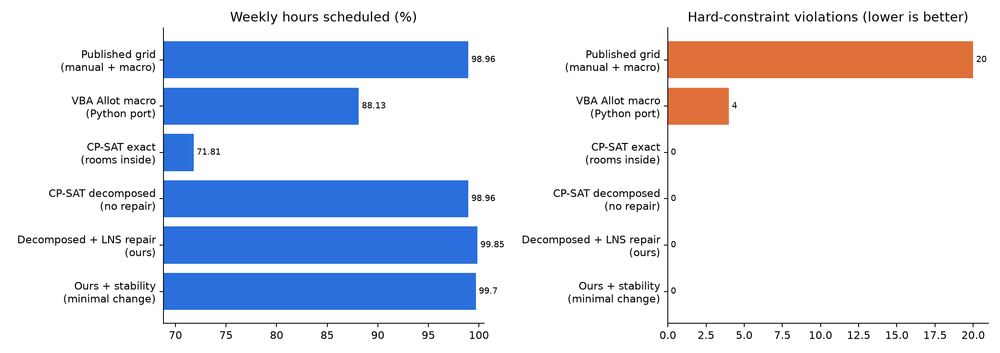
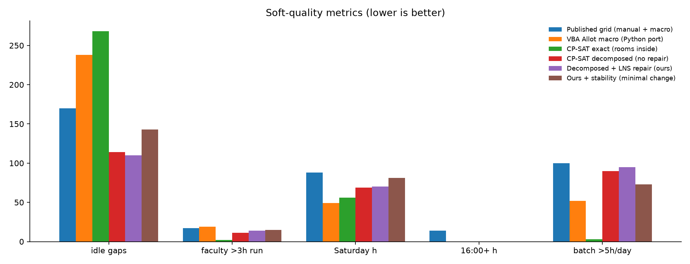
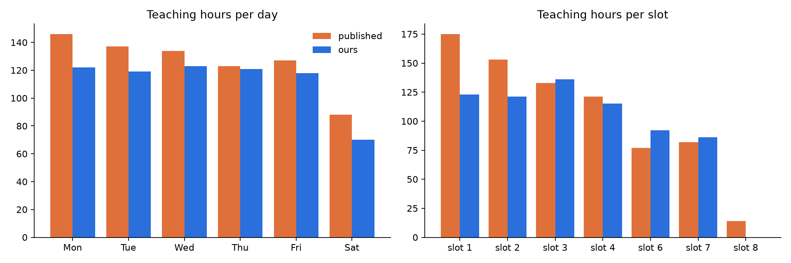
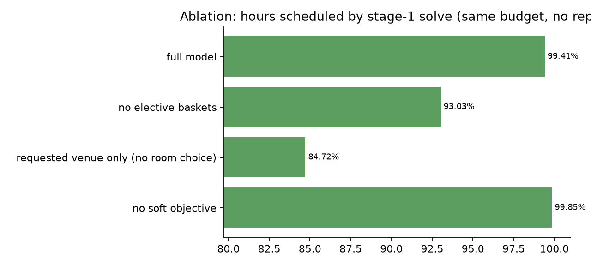

# Agentic University Timetabling on Real Institutional Data
### LangGraph multi-agent orchestration over MCP with a decomposed CP-SAT engine

*M.Tech (3rd sem) Deep Learning project, v2. Data: Master_TimeTable_July-Dec-2026 (updated 23 July).
All numbers below come from `python -m scripts.run_experiments --time 60` on a 2-core machine;
raw data is in `experiments/results/`.*

---

## Abstract

We replace a spreadsheet-macro timetabling process with an agentic system. LLM agents,
orchestrated as a LangGraph state machine, can only act through typed Model Context Protocol
(MCP) tools. Those tools wrap a deterministic constraint-programming engine and an independent
validator. On the institution's real workbook (348 requirements, 674 teaching hours/week,
54 batches, 38 rooms) we show four things.

1. The macro's implicit model is **provably infeasible**: 23 batches need more hours than the
   week offers.
2. Two modelling corrections recovered from the data make the problem solvable: parallel
   **elective baskets** inferred from human co-scheduling, and **room choice** in place of
   fixed venues.
3. A **time-then-room CP-SAT decomposition with LNS repair** schedules 99.85–100% of hours with
   **zero** hard violations. The published hand-edited grid reaches 98.96% with 20 violations;
   the macro reaches 88.13%.
4. **Minimal-perturbation repair** absorbs a teacher's sudden unavailability by touching only
   0.5–7.2% of sessions.

---

## 1. Problem and data

| Item | Value |
|---|---|
| Requirement rows (Main!K:V) | 348 → 567 weekly sessions, **674 h/week** |
| Semesters / batches | 1, 3, 5, 7 / 54 internal + 7 external (BBA, MCA, ...) |
| Faculty codes | 78 (10 department placeholders: HSS\*, OTH\*, RSCH\*, ECE\*) |
| Rooms | 38: 11 lecture theatres, 16 classrooms, 6 computer labs, 4 special labs, 1 DLC |
| Week | Mon–Fri slots 1–4, 6–7; Sat 1–4; lunch = slot 5 → **34 teachable h per resource** |
| Session token | `BATCHES:KIND-COURSE@VENUE_FACULTY`, e.g. `1B1,1B2:P-CPLAB@CL3_REENU,RP` |

**Data quality (ingestion report).**
* 1 malformed token was recovered.
* 1 junk cell was ignored.
* 8 normalisations were applied (`DuMKA`, `_Extra`, `-EXTRA`, `_CR17`).
* The requirement table and the published grid disagree in 49 faculty cells and 140 venue cells.
* 9 kinds of grid entries had no requirement row (manual splits/additions).
* The macro's own bookkeeping marks **40 requirements (84 h)** as not fully scheduled.

## 2. RQ1: Is the institution's model feasible?

A pigeonhole argument settles it without search. If any resource needs more hours than it
has available, no timetable exists.

| Model | Over-capacity resources | Verdict |
|---|---|---|
| Strict ("no two sessions may share a batch", as in VBA `intersect`) | 12 sem-7 batches need **42 h**; 11 sem-5 batches need **35 h** (capacity 34) | **provably infeasible** |
| Elective-basket aware | none (max batch utilisation 88.2%) | feasible in principle |
| Requested venues as hard constraints | LT4 51 h, LT7 48 h, LT2 44 h, LT3 42 h, LT6/LT1/DLC 40 h | infeasible → venues are preferences |

**Finding 1.** The macro does not fail because greedy search is weak. It fails because its
constraint model is wrong for this institution.

**Finding 2.** The published grid quietly fixes this by running electives in parallel. We
recover those baskets automatically: courses whose batches overlap but which staff placed in
the same slot form a co-occurrence graph, and its connected components give
**7 baskets**:
* S5: {AI, PEGAI}, {IQC, MSA}
* S7: {3DP, ITS, KM, OR}, {AADL, AIESE, TM}, {AW, IFM, LEIB}, {DL2, SQM}, {GAI, IP, LLMGAI}

Semantics: an elective section blocks only *its own* batches. Blocking the whole cohort
over-constrains semester 5, because RATHI teaches two AI sections.

## 3. Method

* **Stage 1 (time).** CP-SAT over `y[s,d,t]` (about 24.6k booleans, 569 Hall cuts per room
  pool and capacity threshold). It is solved lexicographically: maximise placed hours, then
  minimise a weighted soft penalty while keeping that placement. Soft terms: idle gaps,
  over 5 h/day per batch, over 3 consecutive hours or over 4 h/day per teacher, Saturday,
  late slots, home-venue contention.
* **Stage 2 (rooms).** A CP-SAT matching that minimises venue changes and oversizing.
* **LNS repair.** Free the most relevant neighbourhood (batch > teacher > venue) and re-solve.
  The ladder is: exact model on 60 sessions → decomposed model on 320 → allow 16:00, with a
  re-seeded retry. A stay-put penalty makes repairs minimal-perturbation.
* **Validator.** Separate code re-derives rules H1–H9 and allocation for any timetable,
  including the human one.
* **Agents.** The supervisor (LLM structured output, rule fallback) routes to:
  requirements (capacity proof) → scheduler → validator ⟲ diagnoser/repairer → approval
  (`interrupt`) → explainer; or to a single-call action agent; or to a ReAct assistant with
  all 30 MCP tools. State is checkpointed in SQLite.

## 4. RQ2: Method comparison (whole university, 60 s budget, 2 cores)

| Method | Coverage | Hard viol. | Idle gaps | Sat h | 16:00+ h | Faculty >3h run | Weekday imbalance | Time |
|---|---|---|---|---|---|---|---|---|
| Published grid (manual + macro) | 98.96% | **20** (5 clashes, 15 outside hours) | 170 | 88 | 14 | 17 | 0.172 | – |
| VBA `Allot` (Python port) | 88.13% | 4 | 238 | 49 | 0 | 19 | 0.569 | 0.03 s |
| CP-SAT exact (rooms inside) | 71.81% | 0 | 268 | 56 | 0 | 2 | 0.070 | 63 s |
| CP-SAT decomposed (no repair) | 98.96% | 0 | 114 | 69 | 0 | 11 | 0.042 | 56 s |
| **Decomposed + LNS repair (ours)** | **99.85%** | **0** | **110** | 70 | **0** | 14 | **0.041** | 97 s |
| Ours + stability (keep published) | 99.70% | 0 | 143 | 81 | 0 | 15 | 0.102 | 98 s |




**Reading the table**
* **Decomposition is what makes the problem tractable.** With the same budget, the monolithic
  model with rooms inside places only 71.8%. The decomposition reaches 99.0% before any repair.
* **Repair closes the gap.** It took the run from 7 unplaced sessions to 1 here, and to 0 in
  2 of 3 seeds (RQ4).
* **Compared with the published grid**, ours has:
  * no clashes and no 16:00/Saturday-afternoon classes,
  * 35% fewer idle gaps,
  * 20% fewer Saturday hours,
  * a 4× more even spread across weekdays.
* **The VBA port reproduces the macro.** It leaves 37 requirements unplaced (macro: 40), with
  a Jaccard overlap of 0.79 on *which* rows fail. That validates it as a baseline.
* **Caveat on soft penalty.** Our total includes a room-change term the published grid is not
  charged for. Excluding it, ours is 1,823 vs 2,762.



*The published bars also count other programmes' cells and each parallel-elective cell
separately. Compare their shapes, not their absolute heights.*

## 5. RQ3: Ablations (stage 1 only, same 60 s, no repair)

| Variant | Coverage | Soft penalty |
|---|---|---|
| Full model | 99.41% | 1,929 |
| No elective baskets | **93.03%** | 1,978 |
| Requested venue only (no room choice) | **84.72%** | 1,850 |
| No soft objective | 99.85% | **2,698** (+40%) |

Both modelling corrections from §2 are worth several points of coverage each. The soft
objective costs nothing in coverage and buys a 40% lower penalty.



## 6. RQ4: Robustness to solver randomness

Seeds 7 / 11 / 23 reached **99.85% / 100% / 100%**, with mean coverage 99.95% and zero hard
violations in every run. Soft penalty was 2,489 ± 167. CP-SAT is a parallel portfolio, so
more cores or time reduce this variance further.

## 7. RQ5: Absorbing disruptions (what-if)

Six random "teacher X is unavailable on day Y" events were applied to the final timetable
and repaired with the minimal-perturbation ladder.

| Faculty / day | Displaced | Hard viol. after | Constraint respected | Sessions touched | Time |
|---|---|---|---|---|---|
| RAVI / Fri | 2 | 0 | yes | 33 (5.8%) | 40 s |
| AKD / Wed | 3 | 0 | yes | 40 (7.1%) | 11 s |
| DRM / Mon | 1 | 0 | yes | 3 (0.5%) | 27 s |
| DKR / Mon | 3 | 0 | yes | 41 (7.2%) | 2 s |
| SG / Fri | 2 | 0 | yes | 31 (5.5%) | 1 s |
| RP / Wed | 3 | 0 | yes | 33 (5.8%) | 10 s |

All displaced sessions were re-placed, and coverage returned to its pre-event value. The
single session still open in two rows was already unplaced before the event.

**Engineering finding.** Before the stay-put penalty, the same repairs moved 35–52% of all
sessions. Two subtle bugs also made warm starts infeasible:
* symmetry-breaking ("instance #0 before #1") conflicts with timetables that were edited later;
* truncated room lists can omit a session's current room.

Fixing both cut disruption by roughly 7–50×.

## 8. RQ6: Agent routing

On a labelled set of 32 requests (all 13 intents, including every example in the original
brief), the offline rule-based supervisor routes **32/32 (100%)** correctly. With an LLM key
the supervisor first tries structured output and falls back to the rules, so it can only add
coverage of free-form phrasing. The ReAct assistant handles everything else.
End-to-end tests verify the generate trajectory:
`capacity_report → get_requirements → generate_timetable → validate_timetable → approval`.

## 9. Threats to validity

* Room capacity is a **proxy**: the maximum number of batches a room has been seen hosting.
  Real seat counts would tighten or relax the room pools.
* Elective baskets are inferred from one term's grid. `electives.yaml` lets the office correct
  them; once set authoritative, they override inference.
* Results use a 60 s budget on 2 cores. Quality is time- and core-dependent; we report seeds
  and keep the validator exact.
* External programmes (BBA, MCA, ...) are treated as fixed. Their own defects are reported
  separately (X\_\* codes).

## 10. Conclusion

The LLM's job here is to choose which question to ask the engine and to explain the answer
in plain language. It was never asked to do arithmetic on room numbers. On real data, the
largest gains came from **modelling recovered from data**: parallel electives and flexible
rooms turn a provably infeasible problem into a solved one. The **decomposition** made it
tractable. **Typed MCP boundaries, independent validation and minimal-perturbation repair**
make the system safe to operate during a live semester.

### Reproduce
```
python -m scripts.ingest
python -m scripts.run_experiments --time 60      # or --time 180 for higher quality
pytest tests -q
```
