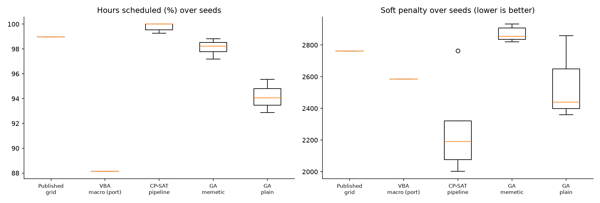
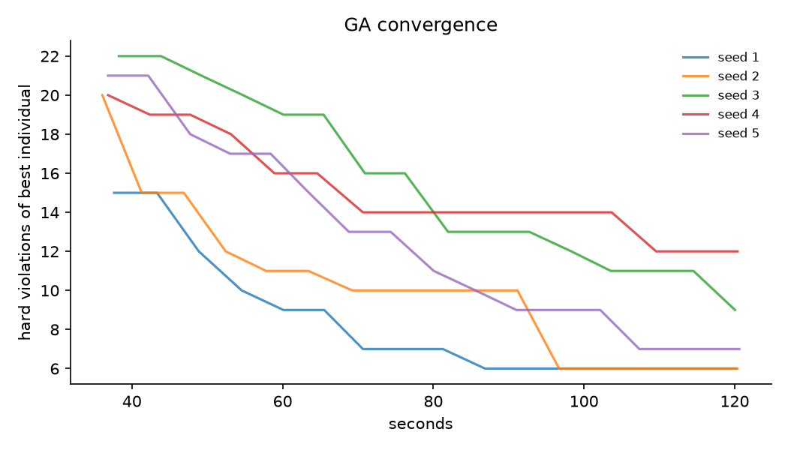
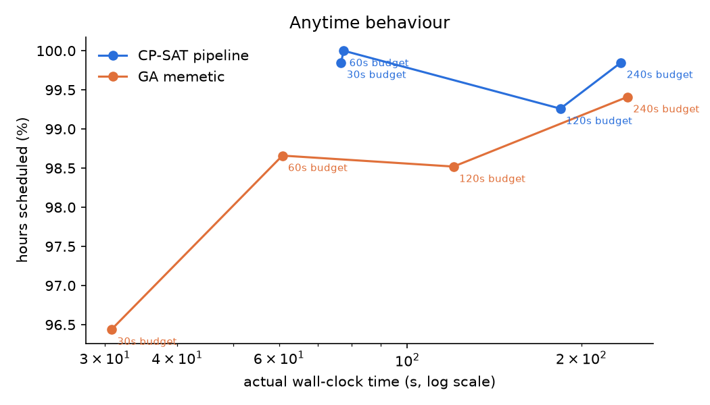
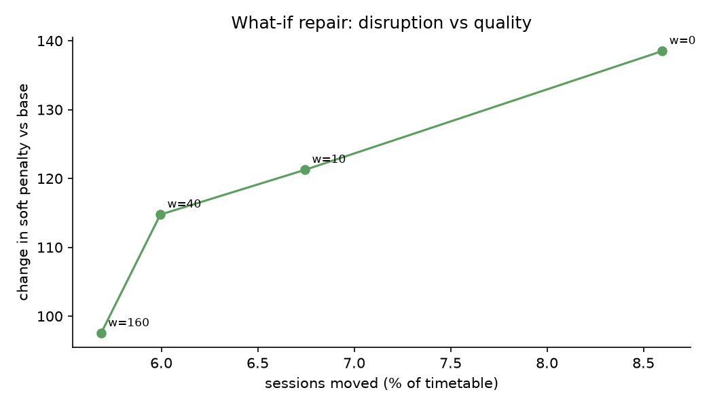
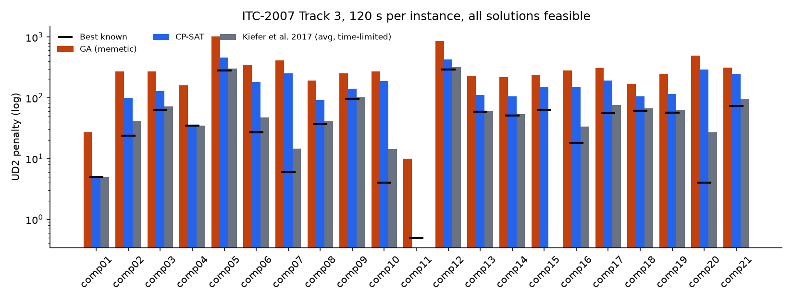
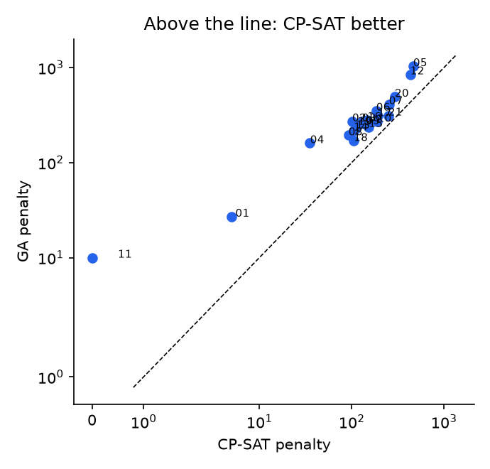

# v3 analysis: GA comparison, public benchmark, qualitative study

This document reports the v3 experiments. It answers three questions from the project review:

1. **How does a genetic-algorithm allocator compare with the CP-SAT pipeline** on the real workbook?
2. **How does the system compare with the existing approach** (Excel + VBA macro, and the published timetable),
   quantitatively and qualitatively?
3. **Do the results transfer to a public benchmark** (ITC-2007 Track 3)?

All numbers come from `experiments/results/v3/` and `experiments/results/itc2007_*`, and can be regenerated:

```bash
ttagent experiments                                  # v2 research questions
python -m scripts.run_analysis_v3 --time 120 --seeds 5   # sections A–E below (~60 min on 2 cores)
ttagent benchmark --time 120                          # ITC-2007, 21 instances (~85 min)
python -m scripts.report_itc                          # ITC figures and table
```

**Hardware.** A 2-core cloud container. CP-SAT uses an 8-worker portfolio on those 2 cores; the GA is
single-threaded Python. Times are wall clock.

## GA-based allocation (comparison method)

A genetic algorithm was added as a second allocator, so the agentic system can be compared with the
most common approach in the timetabling literature. The timetabling literature shows that plain GAs
are weak on highly constrained problems. Lewis and Paechter (2007) found that their grouping GA did best
with its crossover removed, and Rossi-Doria et al. (2002) found no metaheuristic best on every instance.
The GA was therefore built as a *strong* memetic baseline rather than a straw man:

| Component | Design |
|---|---|
| Encoding | Direct: one gene `(day, start slot, room)` per weekly session, drawn only from legal candidates (lunch, lab-block contiguity, Saturday cut-off, fixed external bookings and unavailability already filtered) |
| Seeding | Randomised most-constrained-first greedy construction, capped at 30 % of the time budget |
| Crossover | Requirement-level uniform crossover: all sessions of one requirement come from the same parent, which preserves day spreads |
| Mutation | Re-sample the gene of a session (rate 0.03 per requirement) |
| Local search (memetic) | Conflict-directed best-improvement moves on sampled candidates; once feasible, soft-improving moves |
| Selection | Tournament (k = 3), steady-state replacement of the worst, elitism, duplicate rejection |
| Fitness | 10 000 × hard violations + soft penalty, using the same soft weights as CP-SAT |
| Evaluation | Incremental occupancy counters, so a move costs O(cells touched). Verified equal to full re-scoring in the tests |
| Output | Sessions still in conflict in the best individual are un-placed, so the result is clash-free and comparable with CP-SAT on coverage |

A *plain GA* variant (no local search) is used as an ablation. The same design, with room-swap moves
added, is used for the ITC-2007 benchmark.

## Public benchmark protocol (ITC-2007 Track 3)

* **Instances:** comp01–comp21 of the curriculum-based course timetabling track, taken from Müller's
  repository (the ITC-2007 winner). Sizes range from 30 courses / 160 lectures (comp01) to 131 courses
  / 434 lectures (comp07).
* **Objective:** the UD2 formulation with the official weights: RoomCapacity 1, MinWorkingDays 5,
  IsolatedLectures 2, RoomStability 1. Hard constraints H1–H4.
* **Scoring:** every solution is re-scored by an independent UD2 scorer (`ttagent/benchmarks/ctt.py`).
  Both solvers' internal costs are verified equal to it.
* **Budget:** 120 s wall clock per instance per method, seed 7, on a 2-core machine. CP-SAT uses its
  parallel portfolio (8 workers); the GA is single-threaded Python.
* **References:** best-known lower and upper bounds, and the time-limited results of Abdullah &
  Turabieh (2012) and Kiefer et al. (2017), are taken from Ceschia, Di Gaspero & Schaerf (2023, Table 13).

## Limitations addressed in v3

| Limitation (v2 report) | v3 change |
|---|---|
| Room capacity was a proxy | Optional `config/rooms.yaml` (real seats) and `config/batches.yaml` (students per batch). When seats are known, suitability uses seats ≥ students; templates are generated from the data |
| Elective baskets inferred from one term | Each basket now has a confidence level (high ≥ 6 co-scheduled cells, medium ≥ 3, low). Non-high baskets are flagged in the data-quality report for confirmation |
| No teacher preferences | Soft "avoid" preferences per teacher (day or day:slot), penalised in CP-SAT and the GA, and reported as a metric |
| Quality depends on time and cores | Anytime study (30–240 s) and a single-thread CP-SAT fairness run |
| No public benchmark | ITC-2007 Track 3, all 21 instances |
| Minimal-change repair may degrade quality (Lindahl et al. 2019) | Disruption-versus-quality trade-off curve over the stay-put weight |
| LLM evaluation | Held-out request set (77 phrasings, 13 intents), automatic faithfulness check of the numbers in explanations, and an LLM-only scheduling baseline |

## Software packaging

* An installable Python package (`pyproject.toml`, version 3.0.0) with a `ttagent` command:
  `serve`, `ingest`, `solve --method {decomposed, exact, ga, ga_plain, vba}`, `validate`, `chat`,
  `demo`, `benchmark`, `experiments`, `llm-eval`, `mcp-tools`.
* A double-click Windows launcher (`TimetableAgent.bat`) that installs on first run, loads the workbook
  and opens the browser; `run.sh` does the same on macOS and Linux.
* Dashboard additions:
  * a method selector (CP-SAT / GA / VBA);
  * a *Methods & compare* page that runs methods head-to-head on the same scope and budget;
  * a *Settings* page whose changes are saved to `config/overrides.yaml`;
  * upload of a new workbook from the browser;
  * the version number and LLM status shown in the sidebar.

## A. Methods on the real workbook (5 seeds, 120 s)

Whole university: 348 requirements, 674 teaching hours a week. Mean ± SD over seeds.

| Method | Runs | Hours scheduled | Hard violations | Soft penalty | Soft per scheduled hour | Idle gaps | Saturday h | Room changes | Teacher >3 in a row |
|---|---:|---:|---:|---:|---:|---:|---:|---:|---:|
| Published grid (macro + manual edits) | 1 | 98.96 % | 20 | 2762 | 4.14 | 170 | 88 | 0 | 17 |
| VBA macro (faithful port) | 1 | 88.13 % | 4 | 2586 | 4.35 | 238 | 49 | 0 | 19 |
| GA, plain (no local search) | 3 | 94.17 ± 1.09 % | 0 | 2553 ± 220 | 4.02 | 112 | 61 | 209 | 20 |
| GA, memetic | 5 | 98.10 ± 0.57 % | 0 | 2870 ± 42 | 4.34 | 124 | 68 | 242 | 20 |
| **CP-SAT pipeline (this system)** | 5 | **99.76 ± 0.31 %** | **0** | **2271 ± 269** | **3.38** | **116** | 77 | 143 | **9** |

**Statistical tests** (two-sided Mann–Whitney U, Cliff's δ as effect size):

| Comparison | U | p | Cliff's δ |
|---|---:|---:|---:|
| Coverage, CP-SAT vs memetic GA | 25 | 0.011 | +1.0 (every CP-SAT run beats every GA run) |
| Soft penalty, CP-SAT vs memetic GA | 0 | 0.008 | −1.0 (every CP-SAT run is better) |
| Coverage, memetic vs plain GA | 15 | 0.036 | +1.0 |

How to read the soft penalty: unscheduled sessions cost nothing, so a method that schedules less can look better.
The plain GA's lower total (2553) comes from scheduling 4 % fewer hours. Per scheduled hour, the ranking is
CP-SAT 3.38 < plain GA 4.02 < published 4.14 < memetic GA 4.34 ≈ VBA 4.35.

**Findings.**

* The memetic GA is a credible baseline: it produces clash-free timetables, beats the VBA macro by 10 points
  of coverage and has fewer idle gaps than the published grid. Its local search matters (+3.9 points over the plain GA).
* CP-SAT is still better on every measure that matters for a timetabling office, and the differences are
  statistically significant with the largest possible effect size, even with only 5 seeds.
* The GA moves rooms far more often (242 room changes vs 143) and gives teachers more long runs (20 vs 9),
  because its operators improve one session at a time; it has no global view of a teacher's day.





The GA spends its first ~35 s building the seeded population (capped at 30 % of the budget), then removes
hard conflicts steadily. In no run did it reach zero conflicts in 120 s; the remaining 6–12 conflicting
sessions are un-placed at the end, which is where its coverage gap comes from.

### Per semester (seed 1)

| Semester | Required h | Published | VBA port | CP-SAT | Memetic GA |
|---:|---:|---:|---:|---:|---:|
| 1 | 286 | 100.0 | 91.6 | 98.6 | 100.0 |
| 3 | 170 | 99.4 | 98.2 | 100.0 | 98.8 |
| 5 | 158 | 100.0 | 84.2 | 99.4 | 94.9 |
| 7 | 60 | 90.0 | 53.3 | 100.0 | 100.0 |

The VBA macro collapses on semester 7 (53 %), the case the capacity proof shows to be infeasible without
elective baskets. Both the GA and CP-SAT use the learned baskets and schedule semester 7 completely. The GA's
weak point is semester 5, the semester with the most lab blocks.

## B. Fairness: CP-SAT with one worker

The GA is single-threaded, so CP-SAT was also run with `num_workers = 1`. **With one worker, CP-SAT found no
feasible solution for the time phase of the whole university** (status UNKNOWN when its share of the budget
ran out after 43 s), and the repair ladder could not start from an empty timetable, so the result was 0 %.

This is an honest limitation: the pipeline relies on CP-SAT's parallel portfolio (feasibility-jump and LNS
workers find first solutions; the default single worker does not, on a 567-session model). On a 2-core
laptop the 8-worker portfolio still works, as all the other results show. A GA does not have this cliff:
it always returns something, which is its main practical advantage.

## C. Anytime behaviour



| Budget | CP-SAT wall time | CP-SAT coverage | CP-SAT soft | GA wall time | GA coverage | GA soft |
|---:|---:|---:|---:|---:|---:|---:|
| 30 s | 77 s | 99.85 % | 2895 | 31 s | 96.44 % | 2730 |
| 60 s | 78 s | 100.0 % | 2628 | 61 s | 98.66 % | 2845 |
| 120 s | 184 s | 99.26 % | 2321 | 120 s | 98.52 % | 2855 |
| 240 s | 234 s | 99.85 % | 1938 | 240 s | 99.41 % | 2986 |

The pipeline does not respect small budgets exactly: the room phase and the repair ladder (minimum 15 s)
come on top of the time phase, so a "30 s" run takes about 77 s. Compared at equal *wall* time, CP-SAT
is still ahead: at ~77 s it has 99.85–100 % coverage, while the GA reaches 98.66 % at 61 s and 98.52 % at 120 s.
More time mostly improves CP-SAT's soft quality (2895 → 1938); more time mostly improves the GA's coverage.

## D. What-if repair: disruption versus quality

Four scenarios (a teacher becomes unavailable for a whole day; 1–3 sessions displaced each) were repaired
from the best CP-SAT timetable with the stay-put weight *w* from 0 to 160. Every repair placed all displaced
sessions, with 0 hard violations and 100 % coverage, in 7–8 s on average.

| Stay-put weight *w* | Sessions moved (mean) | % of timetable | Soft penalty change | Mean time |
|---:|---:|---:|---:|---:|
| 0 | 48.8 | 8.6 % | +138.5 | 7.7 s |
| 10 | 38.3 | 6.8 % | +121.3 | 8.4 s |
| 40 (default) | 34.0 | 6.0 % | +114.8 | 8.3 s |
| 160 | 32.3 | 5.7 % | +97.5 | 6.9 s |



Lindahl et al. (2019) found that forcing a repaired timetable to stay close to the original can cost quality.
Here the opposite happens: **a higher stay-put weight gives both fewer changes and a smaller loss of
quality.** The reason is that repair optimises feasibility and stability only (soft terms are switched off for
speed), so any session it moves without need lands in an arbitrary legal slot, usually a worse one. When the
starting timetable is already optimised, staying close to it is the best way to keep its quality. The
default *w* = 40 is a reasonable middle; *w* = 160 is better on both axes in this sample of four scenarios.

## E. Public benchmark: ITC-2007 Track 3

All 21 curriculum-based instances, 120 s each, seed 7. Every solution of both methods is feasible
(0 hard violations) and was re-scored by the independent UD2 scorer. Bold = better of our two methods.

| Instance | Lectures | Best known (LB–UB) | GA | CP-SAT | CP-SAT bound | Kiefer'17 avg | A&T'12 avg |
|---|---|---|---|---|---|---|---|
| comp01 | 160 | 5–5 | 27 | **5** (opt) | 5 | 5.0 | 5.0 |
| comp02 | 283 | 24–24 | 272 | **101** | 10 | 41.5 | 36.36 |
| comp03 | 251 | 58–64 | 272 | **129** | 24 | 71.7 | 74.36 |
| comp04 | 286 | 35–35 | 160 | **35** (opt) | 35 | 35.1 | 38.45 |
| comp05 | 152 | 247–284 | 1034 | **464** | 80 | 305.2 | 314.45 |
| comp06 | 361 | 27–27 | 352 | **184** | 8 | 47.8 | 45.27 |
| comp07 | 434 | 6–6 | 412 | **253** | 0 | 14.5 | 12.0 |
| comp08 | 324 | 37–37 | 194 | **92** | 36 | 41.0 | 40.82 |
| comp09 | 279 | 96–96 | 254 | **142** | 30 | 102.8 | 108.36 |
| comp10 | 370 | 4–4 | 270 | **190** | 4 | 14.3 | 8.36 |
| comp11 | 162 | 0–0 | 10 | **0** (opt) | 0 | – | – |
| comp12 | 218 | 248–294 | 849 | **431** | 82 | 319.4 | 320.27 |
| comp13 | 308 | 59–59 | 229 | **111** | 58 | 60.7 | 64.27 |
| comp14 | 275 | 51–51 | 218 | **105** | 50 | 54.1 | 64.36 |
| comp15 | 251 | 58–64 | 237 | **153** | 26 | – | – |
| comp16 | 366 | 18–18 | 281 | **148** | 12 | 33.8 | 23.73 |
| comp17 | 339 | 56–56 | 309 | **191** | 26 | 75.7 | 76.36 |
| comp18 | 138 | 61–61 | 169 | **105** | 22 | 66.9 | 75.64 |
| comp19 | 277 | 57–57 | 250 | **116** | 42 | 62.6 | 66.82 |
| comp20 | 390 | 4–4 | 493 | **293** | 0 | 27.2 | 13.45 |
| comp21 | 327 | 74–74 | 313 | **249** | 14 | 97.0 | 100.73 |

Median gap to best-known UB: GA (memetic) 357.1%, CP-SAT 105.9%. CP-SAT beats GA on 21/21 instances.





**Findings.**

* CP-SAT beats the memetic GA on **all 21 instances**, consistent with the real-data result.
* CP-SAT **proves optimality** on comp01 (5), comp04 (35) and comp11 (0), matching the best known values,
  and on comp08, comp13 and comp14 its lower bound is within 1 of the best known.
* On the other instances, at 120 s on 2 cores, both methods are far from the state of the art. Median gap to
  the best known upper bound: CP-SAT 106 %, GA 357 %. The time-limited results of Kiefer et al. (2017) and
  Abdullah & Turabieh (2012) are much better on most instances. These are dedicated metaheuristics tuned for
  this benchmark, with longer runs on faster machines.
* The worst gaps are on instances with very small optima (comp07, comp10, comp20: best known 4–6), where a
  general-purpose model leaves a few hundred penalty points of isolated lectures and room instability.

**Pilot: outer LNS around CP-SAT.** `ttagent/benchmarks/ctt_lns.py` adds a destroy-and-repair loop (free a day,
a group of curricula or a set of rooms, fix everything else, re-solve for 4 s). On comp02 with 120 s it reached
102, against 101 for plain CP-SAT: no gain at this budget, because CP-SAT's own portfolio already contains LNS
workers. It is kept as an option (`ttagent benchmark --only-lns`) for longer runs.

**What this means for the claims.** The project does *not* claim a new state of the art on ITC-2007. The
benchmark shows that (i) the CP-SAT model is correct and general (it solves a standard formulation and proves
optimality where the instance is small enough), and (ii) the ranking CP-SAT > memetic GA observed on the
institution's data also holds on public data. The project's contribution is the agentic, explainable,
repairable system around the solver, measured on real institutional data.

## Qualitative comparison

Numbers say how good a timetable is; they do not say whether a timetabling office can live with the
tool that made it. The table compares the four approaches on properties that matter in practice.
Each entry is backed by something observable in this repository (a test, a log, or an output file).

| Property | Excel + VBA macro (existing) | Genetic algorithm (memetic) | CP-SAT alone | This system (agents + MCP + CP-SAT) |
|---|---|---|---|---|
| Hard constraints guaranteed | No: first-fit greedy, 4 violations in our port, 20 in the published grid after manual edits | Only by un-placing conflicting sessions at the end | Yes, by construction | Yes, and re-checked by an independent validator (H1–H9) |
| Says when the problem is impossible | No: rows are silently left empty | No: a high penalty looks the same whether the problem is hard or impossible | Yes (INFEASIBLE), but without a reason | Yes: a capacity proof (semester-7 needs 42 h in a 34-h week), plus a per-slot blocker report |
| Quality bound | None | None | Lower bound from the solver | Same bound, reported to the user |
| Explains a missing class | No | No | No | `explain_unplaced`: for every slot, which batch, teacher or room blocks it |
| What-if change (teacher absent) | Re-run the whole macro, then fix by hand | Re-run; the new timetable can be completely different | Re-solve from scratch | Minimal-change repair: only a neighbourhood is freed, and a stay-put weight controls disruption |
| Reproducible | Yes (deterministic) | Varies with the seed (SD of coverage 0.57 pp over 5 seeds) | Varies a little (parallel search) | Same as CP-SAT, and every version is stored with its parent |
| Human control | Full, but manual | Parameters only | Model only | Natural-language requests, approval before publishing, pinned sessions, settings page |
| Audit trail | None | None | None | Every MCP tool call logged with arguments and latency; versions form a history |
| Effort to add a rule | Edit VBA | Write a new penalty and repair move | Add a constraint | Add a constraint; agents and tools are unchanged |
| Runs without an LLM | Yes | Yes | Yes | Yes: rule-based supervisor; the LLM only adds free-form questions and wording |

### Case study: what each timetable looks like for one batch

The heatmaps (`fig_v3_heatmaps.png`) show one week for four batches, one per year. Reading them side by side:

* **Year 1 (1B1).** The published grid and the CP-SAT timetable are both full-day patterns with the lunch slot
  free. The GA packs the whole batch into mornings and leaves Saturday afternoon and most afternoons free,
  because its local search reduces idle gaps first. This is legal but uneven: four or five classes in a row
  every morning.
* **Year 3 (3B1).** CP-SAT leaves Tuesday morning almost empty and moves the load to afternoons. That is
  what its weights ask for (balanced days, few late hours), not a defect, but it is a choice a coordinator
  might want to change. The settings page now exposes those weights.
* **Years 3 and 4 (5B1, 7B1).** The red crosses are elective baskets: parallel electives taught to different
  sub-groups in the same slot. All three timetables have them; they are legal by design. The published
  7B1 timetable has them concentrated in the first two morning slots; CP-SAT and GA spread them out.

### Explainability example

The `explain_unplaced` MCP tool was run on the **published** timetable (real output, abridged). One of the two
weekly CMD lectures for batches 3B7–3B9 (teacher NEEJ, requested room LT2) is missing from the published grid.
The tool checked all 34 possible start slots and reported:

* the blockers across those slots: batch busy in 32, room LT2 busy in 30, teacher busy in 11, same-day rule in 4;
* no slot where LT2 itself is free and everyone can attend;
* **one fix by changing room: Monday 11:00–12:00 in LT4 or LT9**, where only LT2 was the obstacle
  (it is taken by the 3B4–3B6 DS lecture);
* slot-by-slot detail, for example *"Tue 09:00: batches 3B7–3B9 busy (DS in LT2), teacher NEEJ busy
  (English lab for 1B6)"*.

A timetabling officer can act on this directly. Neither the macro nor the GA can produce it: the macro has no
model of why it failed, and a GA only knows a penalty total.

## Threats to validity

* **Compute.** Two cores only; CP-SAT's portfolio is sensitive to cores (section B), so results on a
  4–8-core laptop should be better, and the GA would not benefit.
* **Seeds.** Five seeds for the main comparison and one seed for the anytime and per-semester studies. The
  significance tests have the smallest sample that can reach p < 0.05; the effect sizes are maximal, but
  more seeds would tighten the confidence intervals.
* **GA tuning.** The GA parameters (population 24, mutation 0.03, local-search sample 60) were set by hand
  on semester 3, not tuned by an automatic configurator such as irace. A tuned GA could narrow the gap.
* **Soft-penalty weights** are the institution's settings, not validated preferences of staff or students.
* **ITC budget.** 120 s per instance on 2 cores is short compared with the competition setting (several minutes per run, scaled by a machine benchmark) and with
  the long runs behind most best-known values; the gaps to the state of the art are partly a budget effect.
* **LLM evaluation.** The offline intent router was evaluated (accuracy 0.92); the LLM-based evaluation
  (`ttagent llm-eval`) needs an API key and has to be run locally.
